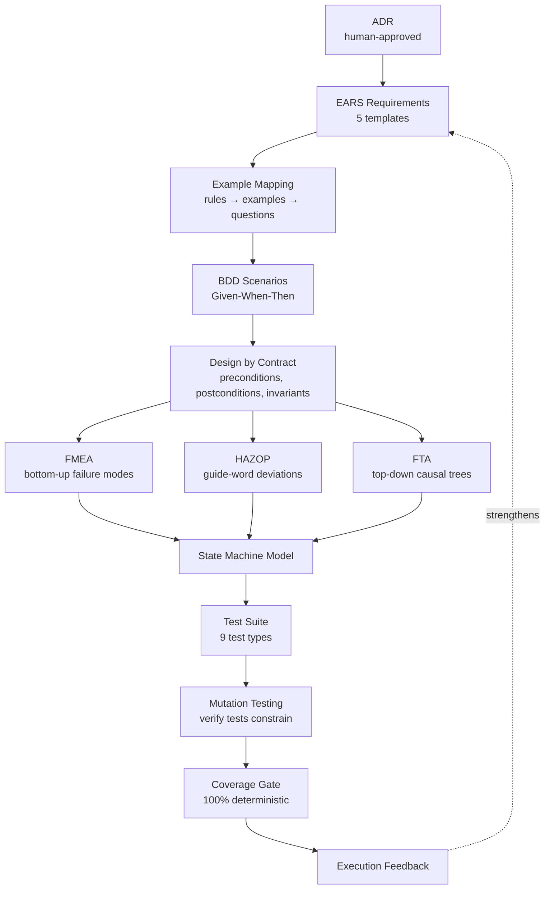

# PROPOSAL: Behavioral TDD Coverage

> **Status: TARGET DESIGN WITH PARTIAL COVERAGE-GATE IMPLEMENTATION** — The full
> behavioral coverage pipeline is not implemented. The PRD/ADR/brief workflow
> has a narrower deterministic coverage evaluator for current fixtures, but it
> is not yet the nine-stage canonical gate and still needs product lint/audit
> authority reuse before dispatch coverage can be treated as complete.
>
> Source: [design-tdd-coverage.md](../design-tdd-coverage.md)
> Depends on: [[20 - PRD ADR Brief Research Workflow PROPOSAL]]

## What This Proposes

A staged pipeline that ensures exhaustive behavioral coverage between a
human-approved ADR and a dispatch-ready implementation brief. No single
technique achieves completeness — the design composes complementary techniques
so their blind spots do not overlap.

## The Pipeline (Serial and Cumulative)

Each stage refines the output of the previous stage. They are not parallel
alternatives. The one parallel section — FMEA, HAZOP, FTA — analyzes the same
Design by Contract output from three different directions simultaneously.

## TODO: Coverage Techniques

### Stage 1: EARS Requirements

Five structured templates that eliminate ambiguous "should" language:

| Pattern | Template |
| --- | --- |
| Ubiquitous | The \<system\> shall \<behavior\> |
| Event-Driven | When \<event\>, the \<system\> shall \<response\> |
| Unwanted Behavior | If \<unwanted condition\>, then the \<system\> shall \<response\> |
| State-Driven | While \<state\>, the \<system\> shall \<behavior\> |
| Optional Feature | Where \<feature\>, the \<system\> shall \<behavior\> |

### Stage 2: Example Mapping

Each EARS requirement → rules → concrete examples (2-4 per rule) → questions.

### Stage 3: BDD Scenarios

Examples become Given-When-Then. Each scenario is an executable specification.

### Stage 4: Design by Contract

Every port boundary gets preconditions, postconditions, and invariants.
Every BDD Then clause maps to a postcondition. Every Given maps to a
precondition.

### Stage 5: Failure Mode Analysis (Parallel Fan-Out)

**FMEA** — enumerate failure modes per component (no function, over function,
under function, intermittent, unintended). Score Severity x Probability x
Detection = Risk Priority Number. RPN >= 21 generates mandatory negative test.

**HAZOP** — apply 11 guide words (No, More, Less, As Well As, Part Of,
Reverse, Other Than, Early, Late, Before, After) to each workflow step.
Severity >= 3 generates mandatory deviation test.

**FTA** — for catastrophic outcomes, build AND/OR fault trees. Each leaf
becomes a test obligation. AND gates indicate where redundant defenses are
needed.

### Stage 6: State Machine Model

Verify reachability, deadlock freedom, safety, and liveness. For
protocol-critical contracts, consider TLA+/Alloy.

### Stage 7: Test Suite (9 Types)

| Type | Covers |
| --- | --- |
| BDD scenarios | Known positive cases |
| Contract tests | Pre/post/invariant at every port |
| Property-based tests | Automated edge case discovery |
| FMEA negative tests | Systematic failure modes |
| HAZOP deviation tests | Guide-word deviations |
| Decision table tests | Exhaustive boolean combinations |
| Boundary value tests | Numeric edge cases |
| Characterization tests | Legacy safety net |
| Approval tests | Behavioral regression |

### Stage 8: Mutation Verification

Inject faults. Score: >=90% strong, 80-89% acceptable, <80% blocks dispatch.

### Stage 9: Coverage Gate (100% Deterministic)

| Criterion | Threshold |
| --- | --- |
| EARS coverage | 100% of ADR consequences mapped |
| BDD coverage | 100% of EARS requirements have scenarios |
| Contract coverage | 100% of Then clauses mapped to postconditions |
| FMEA coverage | 100% of RPN >= 21 failure modes have tests |
| HAZOP coverage | 100% of severity >= 3 deviations have tests |
| Decision table coverage | 100% of multi-condition decisions enumerated |
| PBT coverage | 100% of invariants have property-based tests |
| Mutation score | >= 80% for contract-level tests |

## TODO: New Obligation Types (7)

- [ ] `property_based` — session invariant holds for arbitrary sequences
- [ ] `fmea_negative` — failure mode with RPN >= 21 mitigated
- [ ] `hazop_deviation` — deviation with severity >= 3 handled
- [ ] `decision_table` — all boolean condition combinations enumerated
- [ ] `boundary_value` — numeric bounds tested at edges
- [ ] `mutation_score` — test suite detects injected faults
- [ ] `post_mortem` — incident produces catching test

Combined with the 8 existing types, the full set is 15 obligation types.

## TODO: Deterministic vs LLM Split

~75% of this pipeline can be deterministic tooling. The LLM is needed at
roughly 5 narrow synthesis points:

| Stage | Deterministic | LLM Needed |
| --- | --- | --- |
| EARS pattern matching | Template application, ID assignment | Choosing pattern, writing prose |
| Example mapping | Schema validation, coverage counting | Proposing examples, resolving questions |
| BDD scenarios | Gherkin syntax validation, data checks | Writing scenario body |
| FMEA enumeration | 5 failure classes, RPN scoring, threshold filtering | Severity/probability/detection ratings |
| HAZOP analysis | 11 guide words per step, severity filtering | Judging physical possibility |
| Decision tables | 2^n generation from booleans | Expected action for rare combinations |
| Boundary values | Extraction + generation | Almost nothing |
| PBT obligations | Invariant extraction from schemas | Prose description |
| Mutation operators | Field-to-operator mapping | Almost nothing |
| Coverage gate | **100%** | **Nothing** |

Architecture: build as deterministic tooling with LLM plugins at synthesis
points, not as LLM-driven workflow with validation bolted on.

## Complementarity (No Overlapping Blind Spots)

| Primary | Complement | Why |
| --- | --- | --- |
| BDD Scenarios | Property-Based Testing | BDD covers known; PBT finds unknown |
| EARS Requirements | FMEA | EARS specifies desired; FMEA specifies undesired |
| Design by Contract | Mutation Testing | DbC defines correct; mutation proves tests detect incorrect |
| State Machine | HAZOP | State machine covers nominal; HAZOP covers deviations |
| FMEA | FTA | FMEA bottom-up; FTA top-down |

## Related Notes

- [[02 - Deterministic Evidence-Based Development]]
- [[05 - Runner Contracts and Control Rails]]
- [[09 - Verification Readiness and Completion]]
- [[10 - Telemetry Audit Eval and Learning]]
- [[20 - PRD ADR Brief Research Workflow PROPOSAL]]
- [[22 - Product Workflow ROADMAP]]
