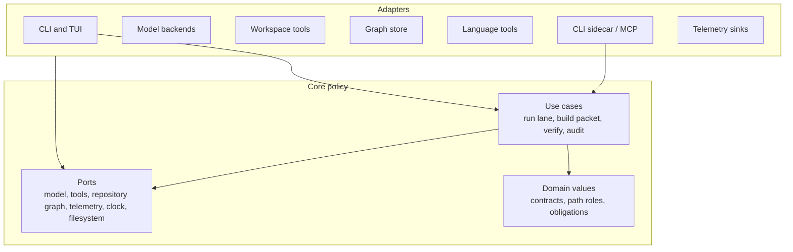
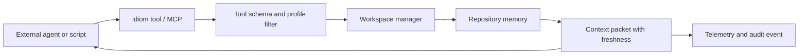
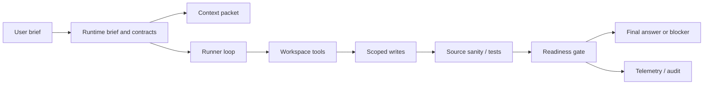
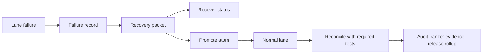
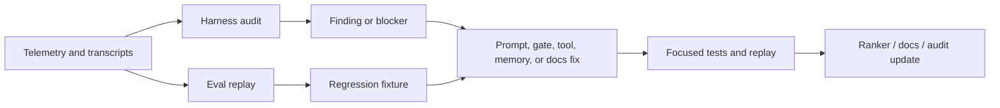
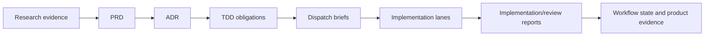
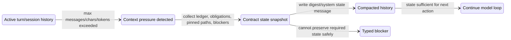

---
tags:
  - idiom
  - implementation-plan
  - architecture
  - rebuild-blueprint
---

# Ground-Up Implementation Plan

This note is the rebuild blueprint for a new Idiom-style project. It describes
the individual implementation efforts, architecture patterns, test strategy,
and quality gates needed to recreate the harness without copying incidental
structure from this repository.

The blueprint is intentionally contract-first:

- The model owns strategy.
- The harness owns contracts.

The goal is not to build another chat UI first. The goal is to build the local
substrate that makes agent work inspectable: repository memory, freshness,
permissions, typed tools, verification, audit, evals, and reusable sidecar
surfaces.

## Product Slice

The first credible product slice should let a user run one local command against
a real repository and receive:

- A fresh repository context packet with ranked files, symbols, tests, and
  uncertainty.
- A tool schema and permission manifest that external agents can consume.
- A read-only audit/status report showing graph freshness, tool availability,
  and privacy-safe evidence.
- One write-capable lane that can edit scoped files, verify the result, and
  produce a final answer or typed blocker.
- Durable telemetry that can explain what happened without raw prompt or file
  body leakage.
- Session and runner state that survive resume, budget pressure, and context
  compaction without losing task obligations or inventing evidence.

Build the system in vertical slices around these outcomes. Avoid spending early
cycles on polish, dashboards, or a large TUI before the contract and evidence
substrate works from the CLI.

## Product Proof Gate

The first production-credible slice must name the buyer, daily user, and proof
of value. Otherwise the rebuild can become a technically impressive local tool
without a clear adoption path.

Required proof:

- Primary buyer and daily user.
- Activation path: install, doctor, `context_pack`, write-capable lane,
  metadata-only evidence export.
- Retained-use signal: repeated use across multiple repositories or multiple
  sessions with privacy-safe validation records.
- Value proof: time saved, unsafe edit avoided, failed run recovered, audit
  finding converted into a fix, or external agent made safer through the
  sidecar.
- No-go criteria: unsupported compliance claim, raw-content export,
  unreproducible install, unverifiable release evidence, or missing evidence
  that the target user would run it again.

## Day-Zero Developer Workflow

A new contributor must be able to clone, verify, and run the walking skeleton
without a live model.

Required commands:

- `make bootstrap` checks required local tools and writes no source files.
- `make dev-smoke` runs tests, build, schema export, one fixture-backed
  `context_pack`, and metadata-only `harness_audit`.
- `make clean-local-state` removes generated `.idiom/`, temp graph stores,
  fixture logs, and local smoke artifacts.

The first successful loop is:

1. `make bootstrap`
2. `make dev-smoke`
3. `idiom doctor --json`
4. `idiom tool schemas`
5. `idiom tool context_pack --input '{"task":"smoke","mode":"plan","limit":5}'`

Document where state is written: repo-local `.idiom/`, user-local `~/.idiom/`,
logs, cache, graph stores, and generated fixture output. If a cleanup command
cannot remove a state path safely, document why and make `doctor` report it.

## Architecture Pattern

Use Clean Architecture with ports and adapters. The core application should not
depend on model SDKs, terminal UI libraries, SQLite drivers, language-server
clients, MCP libraries, shell commands, or vendor APIs.



Core rules:

- Define use cases before adapters: `RunImplementLane`, `BuildContextPacket`,
  `VerifyChangedPaths`, `EvaluateReadiness`, `ExportToolSchemas`,
  `AuditHarnessState`.
- Keep domain values small and explicit: `PathRole`, `ToolProfile`,
  `Obligation`, `EvidenceRef`, `FreshnessState`, `ReadinessState`,
  `ArtifactState`.
- Make ports narrow. A model port should exchange messages and tool calls, not
  expose provider-specific clients. A graph port should return facts and
  provenance, not raw SQL rows.
- Put composition in one outer layer. Use cases receive ports; they do not
  construct SQLite connections, shell runners, model clients, or telemetry
  writers.
- Treat prompts as interface text. Stable invariants belong in schemas, gates,
  state machines, tests, and telemetry.
- Inner use cases own the required interfaces they need. Outer adapters
  implement those interfaces and translate external types at the edge.

Recommended patterns:

| Pattern | Use it for | Avoid |
| --- | --- | --- |
| Ports and adapters | Model backends, filesystem, graph store, language tools, MCP, shell | Importing vendor/client types into use cases |
| State machines | Lane phases, artifact intake, recovery packets, readiness | Inferring terminal state from prose |
| Strategy registry | Capability adapter selection and model backend roles | Prompting the model to choose low-level backend names |
| Repository/gateway | Graph persistence, ranker state, workflow artifacts | Passing SQL rows or file paths as domain policy |
| Event log | Telemetry, audit correlation, recovery evidence | Raw transcript-only diagnosis |
| Value objects | Paths, roles, freshness, permissions, obligations | Magic strings spread across prompts and handlers |
| Contract tests | Tool schemas, sidecar envelopes, lane phase permissions | Snapshot-only tests of long prose |

## System Invariants Registry

These invariants are non-negotiable. They should exist as typed rules, tests,
and audit signals rather than repeated prompt reminders.

| Invariant | Owner | Proof |
| --- | --- | --- |
| Writes require approved path role and lane phase | Workspace and contracts | Permission denial tests |
| Final success requires readiness closure | Runner and readiness | Unsupported-final tests |
| Freshness claims require current fingerprints | Repository memory | Stale-cache tests |
| Shareable durable evidence excludes raw private content | Evidence pipeline | Forbidden-marker tests |
| Compaction preserves obligations but creates no source proof | Session and runner | Compaction state tests |
| Prompt text cannot grant permissions, freshness, or completion | Runtime contracts | Prompt/change regression tests |
| Adapters cannot leak vendor types into core contracts | Architecture boundary | Import-boundary checks or review gate |
| External integrations reuse first-party tool contracts | Sidecar/MCP adapters | CLI/MCP parity tests |

## Suggested Package Shape

Prefer package names that describe domain responsibility instead of generic
technical buckets. A fresh project can start with this shape and split packages
only when the public contract becomes stable.

| Area | Example package | Owns | Must not own |
| --- | --- | --- | --- |
| Domain contracts | `internal/contract` | Path roles, tool profiles, obligations, readiness states, artifact states | Filesystem or model clients |
| Application use cases | `internal/usecase` | Lane orchestration, context packet building, verification coordination, audit export | CLI formatting or SQL |
| Ports | `internal/port` | Interfaces for model, graph, telemetry, filesystem, clock, shell, language tools | Adapter implementation details |
| Workspace tools | `internal/workspace` | Tool registry, schema export, dispatch, permissions, normalized tool results | Model strategy |
| Repository memory | `internal/memory` | Graph indexing, packets, freshness, views, ranker evidence | Prompt assembly |
| Runner | `internal/runner` | Model loop, tool-call parsing, redirects, readiness gate integration | Backend-specific SDK logic |
| Lane adapters | `internal/lane` | `implement`, `plan-execute`, artifact intake, recovery integration | Domain state names duplicated from `contract` |
| Session state | `internal/session` | Transcript state, resume handles, context compaction, task-state summaries | Replacing source evidence with summaries |
| Telemetry and audit | `internal/evidence` | Redacted events, audit summaries, eval fixtures, product/release evidence | Raw private content export |
| Model adapters | `internal/model` | Local and hosted backend clients behind the model port | Tool permissions or readiness rules |
| CLI surface | `cmd/idiom` | Flags, command wiring, output formatting, composition root | Business rules |
| Integration adapters | `internal/sidecar`, `internal/mcp` | CLI tool envelope, MCP transport, profile filtering through shared tools | Separate tool implementation |

The exact names can change, but the ownership must not blur. If a package
starts importing both terminal UI code and graph persistence, split the use case
from the adapter.

Dependency rule: packages may depend inward only. Domain and contract packages
define stable state and invariants. Application use cases own the ports they
need. Adapters implement those ports and translate external types. CLI, TUI,
sidecar, MCP, SQLite, language-server, shell, and model SDK types must not
appear in domain or use-case contracts.

Avoid turning `internal/usecase` or `internal/port` into generic buckets. Prefer
ports near the use case or capability that owns them until a shared boundary is
proven stable.

## Implementation Efforts

For broad design-doc implementation in an existing Idiom repository, use
[Design Doc Implementation Workflow](../design-doc-implementation-workflow.md)
before dispatching the efforts below. The workflow requires full design review
when architecture or harness contracts change, durable reviewer evidence,
implementation atoms with explicit scope and verification fields, safe
parallelization only across disjoint write scopes, docs freshness checks, and a
final full-bench review before commit and push.

Build each effort with an explicit use case, boundary contract, tests, and
operator command before moving on.

The contract-capability overhaul has begun with a phase 1 foundation:
`internal/contractcompile` is a pure, report-only compiler for the plan-execute
planner contract. It does not replace runner gates yet; it establishes stable
contract, runtime-envelope, protocol-projection, path-role, obligation, and
import-boundary tests that later migration atoms can consume.

| ID | Effort | Outcome | Primary tests |
| --- | --- | --- | --- |
| E00 | Project skeleton | Go module, CLI entrypoint, config loading, build/test scripts, docs skeleton | `go test ./...`, CLI version smoke |
| E00a | Developer bootstrap | Make targets, example config, fixture repo, local-state cleanup, first-run smoke | Bootstrap smoke, cleanup idempotence, doctor JSON smoke |
| E01 | Domain contracts | Types for path roles, tool profiles, obligations, evidence refs, freshness, readiness, artifact states | Pure unit tests for state transitions and validation |
| E02 | Telemetry substrate | Redacted event writer with command IDs, session IDs, correlation IDs, and bounded summaries | Event schema tests, forbidden-marker redaction tests |
| E03 | Tool schema registry | Machine-readable schemas, side-effect metadata, profile filtering, schema export | Schema golden tests, strict JSON validation |
| E03a | Minimal sidecar schema smoke | `idiom tool list/help/schemas` and one read-only fixture-backed tool through the stable envelope | CLI envelope tests, profile denial test, schema strict-decode test |
| E04 | Workspace manager | Dispatch gate for read/search/write/shell tools with path-role enforcement | Permission tests, protected-path denial tests, dirty-worktree tests |
| E04a | Security hardening | Threat model, trust boundaries, secret scanner integration, symlink/path traversal policy, shell/network policy, dependency provenance | Threat-model checklist, traversal/symlink tests, secret fixture tests, denied-network/shell tests, dependency audit smoke |
| E05 | Model backend port | Provider-neutral message/tool-call protocol plus local and hosted adapters | Fake-model runner tests, backend config tests |
| E06 | Runner loop | Tool-call parsing, tool dispatch, result feedback, final attempts, loop fuses | Runner unit tests with scripted model turns |
| E06a | Context lifecycle and compaction | Session history, runner turn state, resume handles, state-preserving context compaction, and compaction telemetry | Compaction tests with task ledger, pinned paths, and fallback digest |
| E07 | Readiness and completion | Harness-computed readiness from obligations, mutations, evidence, and verification | Unsupported-final rejection tests, blocker terminal tests |
| E08 | Verification tools | `source_sanity`, command verification records, post-write proof classification | Source-sanity tests, command-result parsing tests |
| E09 | Repository index | Collect files, packages, symbols, imports, tests, calls, diagnostics, fingerprints | Graph fixture tests, collector fallback tests |
| E10 | Freshness and cache | Scoped freshness checks, read-through repair, content-addressed view cache | Cache hit/miss tests, stale-source invalidation tests |
| E11 | Context packet use case | `context_pack`, `context_query`, `context_zoom`, impact, trace attachment | Ranked packet fixture tests, provenance/freshness tests |
| E12 | Capability resolver | Map task-level capabilities to graph, language, structural, shell, or fallback adapters | Adapter selection tests, degraded-mode tests |
| E13 | Implement lane | Write-capable lane with context preload, scoped tools, verification, readiness closeout | End-to-end fake-model lane tests |
| E14 | Plan-execute lane | Read-only planner, typed plan artifact, executor validation, edit dispatch, review-repair | Planner permission tests, executor scope/anchor tests |
| E14a | Architect and brief tooling | Architect packets, plan audit, context-budget experiments, brief lint/preload/preview, artifact generation | Packet audit tests, brief lint tests, no-tool artifact tests |
| E15 | Artifact intake | Classify dispatchable, source-satisfied, stale, dirty, missing-scope, complete, failed-refine | Artifact-state table tests |
| E16 | Recovery | Failure records, decomposition packets, promote/status/reconcile commands | Recovery packet tests, reconciliation proof tests |
| E17 | Audit and eval | Harness audit, behavior classifiers, replay fixtures, regression evals | Eval fixture tests, audit correlation tests |
| E17a | Operational evidence commands | Lane history/explain/post-analyze/postflight, audit watch, product evidence, release evidence, local-ops benchmark | Command contract tests, metadata-only export tests |
| E18 | Ranker learning | Evidence-only learning log, manual boost/penalize, rollback, audit summary | Ranker update tests, no-op evidence tests |
| E19 | Sidecar CLI | `tool list/help/schemas/<name>` with stable envelope and profile permissions | CLI contract tests, external-agent smoke |
| E20 | Inbound MCP* | Discovery-profile MCP server sharing schemas, permissions, telemetry, and freshness | Protocol tests, profile denial tests |
| E20a | External orchestration templates* | Installable skill templates and project overlays for Claude/Codex-style orchestrators | Template list/install tests, overwrite and path-safety tests |
| E21 | Local model ops | Doctor, backend start/stop/status, route roles, queue admission, degraded mode | Doctor fixture tests, queue admission tests |
| E21a | Operational reliability | Runbooks, incident classes, capacity budgets, degraded-mode policy, cleanup/retention, backup/restore for local artifacts | Runbook smoke tests, capacity/queue saturation tests, retention cleanup tests, restore fixture tests |
| E22 | Product workflow* | Evidence to PRD, ADR, TDD obligations, coverage gate, dispatch-ready briefs | Workflow transition tests, coverage-gate tests |
| E23 | TUI/operator surface* | Read-only presenters first, write actions only after CLI contracts are stable | Presenter tests, parity tests against CLI state |
| E24 | Packaging and bootstrap | `init`, installer, version stamping, release evidence, product-evidence export, docs, support boundary | Init/version tests, release smoke, metadata-only evidence tests |
| E24a | Release engineering | Reproducible builds, checksums/signing, SBOM, installer rollback, compatibility matrix, release notes, staged/canary smoke | Install/upgrade/rollback smoke, checksum/signature verification, SBOM generation, matrix smoke, release evidence gate |

`*` marks efforts that can be roadmapped after the first CLI sidecar and
write-capable lane prove the substrate.

## Deliverables By Effort

Each effort should ship more than code. It should publish a contract that other
efforts can consume, plus a small operator-visible proof that the contract
works. Without those deliverables, features tend to become isolated demos.

| Effort band | Required deliverables |
| --- | --- |
| Foundation | Domain type definitions, schema versions, strict decoders, config shape, redaction policy, CLI smoke command |
| Workspace and tools | Tool schema, side-effect metadata, permission decision type, normalized result envelope, profile allow/deny tests |
| Runner and session | Runtime contract object, tool-call protocol, task-ledger state, readiness state, compaction event, transcript summary |
| Repository memory | Graph schema, collector manifest, freshness contract, packet schema, cache invalidation rules, packet provenance |
| Lanes and artifacts | Lane phase contract, phase tool profile, plan/artifact schema, intake state machine, handoff evidence bundle |
| Verification and readiness | Verification result type, command evidence parser, source-sanity result, completion-gate reasons, blocker shape |
| Recovery | Failure record schema, recovery packet schema, promotion contract, reconciliation proof contract, recovery status view |
| Audit and eval | Event taxonomy, replay fixtures, audit findings, eval scenario format, regression promotion rules |
| Sidecar and MCP | Stable tool envelope, caller metadata, profile filter, protocol mapping, parity tests against CLI tools |
| Operations and product | Doctor readiness report, queue lease contract, product/release evidence schemas, metadata-only export policy |

Every deliverable should answer:

- What type or schema does this effort publish?
- Who is allowed to write it?
- Who is allowed to consume it?
- What makes it fresh or stale?
- What event proves it was produced?
- What test fails if a downstream consumer receives a malformed version?

## Contract Map

Use this map to keep the parts connected. Each row is a boundary where one
feature depends on another feature's typed output.

| Producer | Contract | Consumers | Must contain | Must not contain |
| --- | --- | --- | --- | --- |
| Config/bootstrap | Runtime configuration and workspace root contract | CLI, runner, workspace, local ops, sidecar | Root, CWD, model/backends, protected paths, prompt/profile settings | Business rules hidden in config strings |
| Domain contracts | Path roles, tool profiles, obligations, artifact states | Workspace, runner, lanes, product workflow, recovery | Stable enum values, validation rules, terminal states | Adapter-specific types |
| Tool registry | Tool schema and side-effect manifest | Runner, CLI sidecar, MCP, audit, docs | JSON schema, profile, side effects, path arguments, result shape | Unregistered hidden tools |
| Workspace manager | Tool decision and normalized result | Runner, sidecar, audit, telemetry | Permission decision, result summary, output/error, warnings, path refs | Strategy prescriptions |
| Repository memory | Context packet and graph view | Lanes, architect packets, sidecar, eval, ranker | `pack_id`, freshness, provenance, candidates, tests, gaps, confidence | Write authority by implication |
| Capability resolver | Capability decision | Model-facing tools, workspace adapters, audit | Requested capability, selected adapter, fallback/degraded state, uncertainty | Prompt-only backend names as the durable contract |
| Runner | Runtime brief, task ledger, readiness state, completion decision | Lanes, telemetry, audit, recovery | Open obligations, side effects, changed paths, verification state, blockers | Final success based only on model prose |
| Context compaction | Compacted state event and digest | Runner, TUI, telemetry, audit | Dropped/retained counts, preserved obligations, pinned paths, fallback marker | New facts or source-proof claims |
| Plan-execute planner | Plan artifact | Executor, review, recovery, audit | Scope, edit steps, anchors, evidence refs, verification obligations, `pack_id` | Unparseable scope hidden in prose |
| Artifact intake | Dispatch state report | Lanes, queue producers, TUI dispatch, product workflow | Dispatchable/source-satisfied/stale/dirty/complete state, reasons, paths | Silent model dispatch for terminal work |
| Verification | Verification evidence record | Readiness, final answer, audit, recovery reconciliation | Command, target paths, result, timing/order after writes, failure reason | Listed commands treated as passed commands |
| Recovery | Failure record and recovery packet | Recover CLI, product status, audit, release evidence | Failure class, partial state, candidate atoms, required tests, source refs | Raw transcript or file-body payloads |
| Telemetry/transcript | Event stream and summaries | Audit, eval, lane history, product/release evidence | Command IDs, session IDs, tool summaries, compaction counts, stop reasons | Shareable raw prompts or secrets by default |
| Ranker learning | Learning event and weights state | Context packet ranking, audit, product evidence | Source, reason, before/after or no-op, rollback ID | Hidden strategy override |
| Product workflow | Effort state, PRD/ADR/TDD/brief artifacts | Lanes, status, release evidence, recovery | Effort ID, phase, artifact paths, coverage obligations, blockers | Progress inferred only from chat text |

Contract rule: a downstream feature may depend only on the producer's typed
contract, not on incidental filenames, prompt wording, or private helper
behavior. If a downstream feature needs a fact that is not in the contract,
extend the producer contract and tests rather than scraping logs or prose.

## Feature Authority And Conflict Precedence

When contracts conflict, the harness resolves authority in this order:

1. User constraints, protected paths, and privacy policy.
2. Runtime contract and lane phase profile.
3. Typed plan, artifact, recovery, or product-workflow scope.
4. Tool schema and permission manifest.
5. Repository packet evidence.
6. Prompt/profile guidance.
7. Model prose.

Lower-authority evidence can inform model strategy, ranking, or diagnostics. It
cannot grant permissions, close readiness, weaken a blocker, override protected
paths, or convert stale evidence into fresh evidence.

## Contract Registry And Schema Evolution

A fresh implementation should maintain a contract registry from the first week.
This can start as Markdown plus checked-in JSON schemas, but it must become the
source of truth for feature interaction.

Registry entries should include:

- Contract name and schema version.
- Owning package or use case.
- Producer commands, events, or use cases.
- Consumer commands, events, or use cases.
- Required fields, optional fields, and unknown-field behavior.
- Freshness, staleness, and invalidation rules.
- Privacy classification: local-only, metadata-shareable, or never-export.
- Migration policy and compatibility window.
- Golden fixture path and focused test command.

Contract definition template:

```markdown
Contract:
Owner:
Producer:
Authorized writers:
Consumers:
Schema version:
Freshness or source fingerprint:
Validation rules:
Redaction class:
Emitted event:
Compatibility policy:
Consumer contract tests:
```

Schema evolution rules:

- Control artifacts such as plans, recovery packets, tool schemas, and
  readiness states should reject unknown fields unless a forward-compatible
  metadata bag is explicitly part of the contract.
- Evidence exports may tolerate additive metadata, but they must never treat an
  unknown field as proof of verification, freshness, permission, or completion.
- Breaking schema changes need a migration command or a hard version gate with a
  clear operator message.
- Every durable artifact should carry the producing binary version, schema
  version, workspace fingerprint where relevant, and contract registry version.
- Deprecation should be evented. If an old contract is still consumed, telemetry
  and audit should report the consumer so removal can be planned.

Minimum registry commands:

```bash
idiom contracts list
idiom contracts show <name>
idiom contracts validate --path <artifact>
idiom contracts diff --from <old> --to <new>
```

These commands are not early product polish. They are development scaffolding:
they make contract drift visible before disconnected features accumulate.

## Feature Interaction Matrix

Use this matrix during planning and review. A feature is not designed until its
upstream inputs, downstream consumers, and composition proof are named.

| Feature | Upstream dependency | Downstream consumers | Composition proof |
| --- | --- | --- | --- |
| Tool schema registry | Domain tool profiles, redaction policy | Runner, sidecar, MCP, docs, audit | Same tool schema used through runner and sidecar |
| Workspace manager | Tool schema registry, path roles, config root | Runner, sidecar, telemetry, recovery | Permission decision and telemetry event share command ID |
| Runner loop | Model port, workspace manager, runtime contract | Lanes, readiness, telemetry, recovery | Scripted fake-model run reaches final or typed blocker |
| Context compaction | Runner/session state, telemetry | Runner continuation, audit, TUI resume | Compacted run preserves obligations and resumes safely |
| Repository memory | Workspace filesystem, graph collectors, freshness policy | Context packets, ranker, lanes, sidecar | Packet freshness and provenance appear in lane telemetry |
| Capability resolver | Tool registry, memory, language adapters | Model-visible tools, audit, degraded mode | Missing adapter returns degraded state, not silent fallback |
| Verification | Workspace manager, shell adapter, source sanity | Readiness, final answer, recovery reconcile | Post-write verification evidence closes a readiness obligation |
| Plan-execute | Context packet, plan schema, artifact intake | Executor, review-repair, recovery | Stale plan is rejected before executor receives write tools |
| Recovery | Runner failure record, verification evidence | Recover CLI, ranker learning, product evidence | Failed lane produces packet that can be promoted and reconciled |
| Audit/eval | Telemetry, transcript summaries, artifacts | Regression suite, product/release evidence | Audit finding can be replayed from structured events |
| Product workflow | Research evidence, PRD/ADR/TDD schemas | Dispatch briefs, lanes, release evidence | Coverage gate blocks brief until obligations are satisfied |
| Local model ops | Config, backend probes, queue state | Runner admission, doctor, degraded mode | Doctor explains backend readiness before a lane starts |

Review rule: if the composition proof requires manual transcript reading, the
feature interaction is not yet engineered. Add a typed event, artifact field, or
test fixture before treating the feature as complete.

## Interaction Flows

These flows are the minimum cross-feature interactions a rebuild should prove.

### Sidecar Discovery Flow



Contract checks:

- Sidecar and MCP use the same registry and workspace manager as the runner.
- Discovery profile denies writes, shell, and unknown side effects.
- Context packets carry freshness and provenance, not edit permission.

### Implement Lane Flow



Contract checks:

- Required edit paths come from the runtime contract, not packet relevance.
- Every write is followed by proportionate verification or a blocker.
- Final answers are accepted only when readiness closes.

### Plan-Execute Flow


Contract checks:

- Planner cannot mutate source.
- Executor consumes only typed plan fields and approved scope.
- Stale anchors and dirty required paths block before edits.
- Review either repairs, passes with proof, or blocks.

### Recovery Flow



Contract checks:

- Failure records cite partial state and stop reasons without raw transcript
  payloads.
- Recovery packets define residual work and required tests.
- Reconciliation closes only after completed atom and verification evidence
  match the packet.

### Audit, Eval, And Learning Flow



Contract checks:

- Audits replay typed events first and raw logs only as local diagnostic input.
- Every behavior fix has a regression fixture or focused test.
- Ranker learning changes evidence ordering, not model strategy authority.

### Product Workflow Flow



Contract checks:

- Each artifact has a schema, owner, status, and evidence refs.
- TDD obligations become dispatch gates, not prose suggestions.
- Product/release evidence consumes durable workflow state and reports, not
  chat transcript guesses.

## Integration Gates

Before declaring an effort complete, run the gate that proves it composes with
the next layer.

| Effort completed | Integration gate |
| --- | --- |
| Tool registry | Export schemas, call one tool through runner and sidecar, verify profile denial |
| Workspace manager | Run read, write, protected-path denial, and telemetry correlation tests |
| Runner loop | Script fake model through tool call, rejection, compaction, verification, and final gate |
| Repository memory | Attach `context_pack` to a lane and prove packet freshness reaches telemetry |
| Plan artifact | Submit through planner, validate through executor, reject stale/out-of-scope case |
| Recovery | Generate from a failed lane, inspect through CLI/sidecar, reconcile required tests |
| Audit/eval | Replay a known failure from structured events and produce a regression fixture |
| Sidecar/MCP | Compare CLI tool and MCP tool outputs for schema/profile parity |
| Product workflow | Generate dispatch brief, run lane, write report, update status, export evidence |

## CI Gates

Pre-merge CI must run without local models or private credentials:

- Format check.
- `go vet ./...`.
- `go test ./...`.
- Race tests for packages with concurrency, queueing, telemetry, session state,
  graph writes, or runner state.
- `go build ./cmd/idiom`.
- Schema and golden validation for tool envelopes, telemetry events, plans,
  packets, recovery artifacts, and product evidence.
- Fixture replay for audit/eval regressions.
- `git diff --check`.

Release CI additionally runs packaging checks, checksum or signature
verification, installer smoke, release evidence export, SBOM generation where
applicable, and rollback rehearsal. CI artifacts must be metadata-safe by
default.

## Definition Of Ready And Done

Use these gates to keep work moving without creating disconnected partial
features.

An effort is ready to implement when:

- The owning package or use case is named.
- The contract registry entry or planned entry is drafted.
- Upstream producer contracts and downstream consumers are listed.
- Required fixture shape is known.
- Privacy classification is decided.
- A focused failing test can be described.
- Degraded-mode behavior is named.
- Operator-visible proof command is known.

An effort is done when:

- The contract exists as typed code and, where durable, schema.
- The operator command or sidecar surface uses the same contract as the runner.
- Positive, negative, degraded, and privacy tests pass.
- Telemetry can identify the run, contract version, decision, and failure
  reason without raw private content.
- Docs include current behavior, not only target behavior.
- A downstream consumer has exercised the contract in at least one integration
  test or smoke command.
- The effort has an explicit non-goal list for tempting adjacent work.

Do not accept "the model handled it in a live run" as a done signal. Live runs
are product evidence only after the typed contract and regression protection
exist.

## Coverage Against Current Idiom Surfaces

The effort list is meant to cover these current repository surfaces:

- Core CLI and interactive entrypoints: `prompt`, `turns-file`, `resume`,
  `list-sessions`, TUI launch, `init`, `version`, and `doctor`.
- Lane and implementation surfaces: `implement`, `plan-execute`, `lane`,
  `atom`, `artifact`, `brief`, `probe`, refine, postflight, history, explain,
  post-analyze, and recovery.
- Repository memory surfaces: `context build/status/query/zoom/pack/impact/trace`
  plus the equivalent `idiom tool context_*` sidecar tools.
- Workspace and integration surfaces: built-in tools, external project tools,
  tool schemas, sidecar envelopes, inbound MCP, outbound MCP registry, and
  installable orchestrator skill templates.
- Operational surfaces: `backend`, `queue`, `local-ops`, route-role decisions,
  command telemetry, debug logs, session summaries, and context compaction.
- Evidence surfaces: `harness_audit`, `audit watch`, eval commands,
  SWE/perf/e2e/analyze commands, ranker commands, product evidence, release
  evidence, and client-demo evidence.
- Product workflow surfaces: research, PRD, ADR, TDD obligations, coverage
  checks, brief generation, workflow state migration, effort indexes, status,
  audit, feedback, and durable effort artifacts.

If a future implementation adds a surface not represented here, add it as an
effort or explicitly mark it as out of scope before using this document as a
rebuild plan.

## Recommended Sequence

### Phase 0: Foundation

Ship E00 through E04 first. This creates the repo, contract vocabulary,
redacted telemetry, tool schemas, and workspace permission boundary.

Done when:

- `go test ./...` passes.
- `make bootstrap` and `make dev-smoke` pass from a fresh clone.
- `idiom version`, `idiom tool schemas`, and a read-only file tool work.
- `idiom tool list`, `idiom tool help <name>`, and `idiom tool schemas` use
  the stable sidecar envelope.
- Protected paths and denied profiles fail closed.
- Telemetry records command IDs and redacted summaries only.

### Phase 1: Model Loop

Ship E05 through E08. Use fake model adapters before real model backends so the
runner loop can be tested deterministically.

Done when:

- Scripted model tests cover valid tool calls, invalid tool calls, no-tools
  fallback, repeated-loop redirects, final attempts, and blockers.
- Writes require scoped permission.
- Post-write verification is recorded before readiness can close.
- Context compaction preserves the original objective, runtime contract, task
  ledger, pinned paths, recent tool results, and blocker state under message or
  character pressure.

### Phase 2: Repository Memory

Ship E09 through E12. Start with Go and generic collectors, but keep the graph
and capability contracts language-neutral.

Done when:

- `context_index` builds a graph for a fixture repo.
- `context_status` reports freshness and collector coverage.
- `context_pack` returns ranked candidates, tests, provenance, freshness, and
  unresolved gaps.
- Cache validation refuses stale referenced-source fingerprints.

### Phase 3: Lanes

Ship E13 through E16. Prefer one robust `implement` lane before `plan-execute`;
then add typed plan artifacts and executor validation.

Done when:

- `implement` can complete a bounded fake-model edit with verification.
- `plan-execute` prevents planner writes and rejects stale or out-of-scope
  executor plans.
- Artifact intake blocks stale, dirty, complete, and source-satisfied work
  before model tokens are spent.
- Recovery packets can be inspected, promoted, and reconciled without raw
  transcript leakage.

### Phase 4: Audit, Eval, And Sidecar

Ship E17 through E20. Make the sidecar reuse the same workspace manager and
schemas; do not build a second tool system for integrations.

Done when:

- `harness_audit` can diagnose tool surface, freshness, readiness, and repeated
  loop issues from structured artifacts.
- Eval fixtures catch at least one known bad behavior per contract family.
- Lane history, explain, post-analyze, postflight, local-ops, product evidence,
  and release evidence all consume structured events rather than raw transcript
  prose.
- `idiom tool context_pack --input ...` returns the stable sidecar envelope.
- MCP exposes only the intended read-only discovery profile if enabled.

### Phase 5: Operations And Product Workflow

Ship E21 through E24 after the substrate is useful from the CLI.

Done when:

- `doctor` reports backend, model, graph, sidecar, eval, and privacy readiness.
- Queue admission prevents local-model capacity failures from becoming
  confusing lane failures.
- Product evidence and release evidence are metadata-only by default.
- Docs explain current behavior separately from roadmapped behavior.

## Development Workflow For A Seamless Rebuild

The implementation plan should be executed as a sequence of thin vertical
slices, not as separate horizontal subsystems. Each slice should touch domain
contract, use case, adapter, telemetry, tests, and docs only as far as needed
to prove one operator-visible behavior.

Recommended working loop:

1. Draft or update the contract registry entry.
2. Add the smallest fixture that represents the behavior.
3. Write the focused contract test first.
4. Implement the inner domain/use-case rule.
5. Add the adapter or CLI wiring.
6. Emit the telemetry or artifact evidence.
7. Run the focused test and the nearest integration test.
8. Update the Obsidian note or operator doc that owns the behavior.
9. Add or update an eval fixture if the behavior protects against model drift.

Required development scaffolding:

| Scaffolding | Purpose |
| --- | --- |
| `make test` / `go test ./...` | Full correctness sweep |
| `make build` / `go build ./cmd/idiom` | Entrypoint and wiring check |
| `make docs-check` | Obsidian links, whitespace, Mermaid parse where available |
| `make schemas-check` | Regenerate and validate contract/tool/artifact schemas |
| `make fixtures-check` | Ensure golden fixtures decode strictly and stay small |
| `make privacy-check` | Run forbidden-marker tests across export surfaces |
| `make audit-smoke` | Replay a small structured run through harness audit |
| `make sidecar-smoke` | Compare first-party command and sidecar envelope behavior |

If a command does not exist yet, create a minimal script or documented manual
equivalent before the related effort is called complete. Missing scaffolding is
itself a project risk because it makes correctness depend on individual memory.

Repository conventions for the new project:

- Keep synthetic fixture repositories tiny and single-purpose.
- Put fake model scripts close to runner and lane tests.
- Store durable JSON fixtures with schema version and a one-line purpose.
- Keep golden outputs small enough to review in diffs.
- Use explicit update commands for goldens; never update them as a side effect
  of a normal test run.
- Track ADRs for architecture decisions that affect contracts, persistence,
  privacy, or public command behavior.
- Maintain a glossary for overloaded terms such as contract, packet, profile,
  artifact, lane, obligation, evidence, and freshness.

## CI And Quality Ladder

Use a quality ladder so developers get fast feedback locally and stronger
evidence before merge.

| Stage | Trigger | Checks |
| --- | --- | --- |
| Inner loop | Every focused edit | Focused package tests, schema decode, targeted fixture |
| Pre-commit | Before staging | Formatting, `git diff --check`, focused tests, docs link check |
| Pull request | Every branch | `go test ./...`, `go build ./cmd/idiom`, schema/golden validation, privacy tests |
| Nightly | Scheduled | Eval replay, audit replay, stale fixture detection, local-model smoke if available |
| Release candidate | Before tagging | Install/bootstrap smoke, sidecar/MCP parity, product/release evidence export, rollback rehearsal |

Quality gates should fail closed on contract, privacy, schema, and readiness
violations. They may warn on optional backend availability, language-tool
coverage, or live-model smoke when the local environment is intentionally
degraded.

## Risk Register

Track these risks from the beginning. Each one should have a detector, a
fallback, and at least one regression test once implemented.

| Risk | Detector | Fallback or response |
| --- | --- | --- |
| Contract drift between runner and sidecar | Schema parity test, `contracts diff` | Generate both from one registry |
| Prompt prose becomes authority | Audit prompt/contract ownership checks | Move invariant into typed gate or schema |
| Context packet treated as edit scope | Readiness and lane scope tests | Require runtime contract required paths |
| Compaction drops obligations | Compaction state test and telemetry counter | Block or fallback digest with preserved ledger |
| Stale graph served as fresh | Freshness validation and source fingerprint test | Read-through repair or stale blocker |
| Privacy leak in exported evidence | Forbidden-marker test and redaction audit | Block export until redaction path is fixed |
| Queue/backend failure looks like model failure | Doctor and queue admission events | Degraded-mode blocker before lane dispatch |
| Recovery packets become stale work queues | Reconcile freshness and required-test checks | Rebase or close packet as obsolete |
| Golden fixtures grow unreadable | Fixture size check | Split fixture or assert typed fields instead |
| External integrations fork tool behavior | Sidecar/MCP parity test | Route through the shared workspace manager |

## Consistency, Concurrency, And Idempotency

Local does not mean single-threaded or single-writer. Interactive sessions,
sidecar calls, graph refreshes, queues, telemetry, and recovery commands can
overlap.

Rules:

- Every command emits a command ID and every child operation carries a parent or
  correlation ID.
- Telemetry writes are append-only, ordered enough for replay, and idempotent
  under duplicate closeout attempts.
- Workspace mutations require a dirty-worktree check and scoped path authority
  at the moment of mutation, not only when the lane starts.
- Graph refreshes use one writer at a time per graph store and publish
  fingerprints only after a complete write.
- Cache writes are content-addressed; duplicate writers may race but must
  converge to the same result or one clear winner.
- Queue leases have owner, deadline, heartbeat, and expired-lease recovery
  semantics.
- Recovery promotion is idempotent: promoting the same atom twice should return
  the existing dispatch record or a typed already-promoted state.
- Migrations use journaled or temporary output and publish the new version only
  after validation succeeds.

Tests should cover duplicate command replay, interrupted graph writes, expired
queue leases, dirty-worktree races, repeated recovery promotion, and migration
partial-write recovery.

## Observability Contract

Define standard signals before shipping a write-capable lane.

| Signal family | Examples |
| --- | --- |
| Counters | Lane starts, completions, blockers, tool denials, verification failures, compactions, stale packets, recovery packets |
| Latency | Model call, tool call, indexing, `context_pack`, verification, queue wait |
| Saturation | Queue depth and age, local backend concurrency, memory pressure, graph freshness lag |
| Quality | Unsupported-final rate, repeated-loop breaks, stale-evidence rejections, recovery success rate |
| Alerts | Raw-content export attempt, protected-path denial spike, release evidence blocker, migration failure, queue starvation |

Observability events should be useful locally without requiring a hosted
dashboard. A simple JSONL replay plus `harness_audit` should answer what
happened, which contract decided, and what the operator should do next.

## Adoption Readiness

Ship the rebuild with enough ergonomic proof that another person can succeed
without the original implementer nearby.

Required assets:

- One-command demo repo and scripted golden path.
- `doctor --explain` output that maps every blocker to a remedy.
- Privacy-safe support bundle command with redaction preview.
- Upgrade guide and known-incompatibilities page.
- External-agent integration examples for CLI sidecar and MCP.
- Success checklist for design partners: install, first packet, first verified
  edit, first evidence export, first recovery.

## Context Compaction As State Mechanics

Context compaction is not a prose summarization convenience. It is a state
transition that keeps long-running work inside model context limits while
preserving the contract state needed for the next safe action.

There are two compaction scopes to preserve in a rebuild:

| Scope | Trigger | State to preserve | Evidence to emit |
| --- | --- | --- | --- |
| Session history | Interactive history grows beyond configured threshold | Original user goal, hard constraints, read/edited paths, tool outcomes, open questions, last blocker | `session_digest` message or equivalent transcript record |
| Runner turn history | Runner message count or character budget exceeds policy | System/user objective, runtime brief summary, task ledger, pinned paths from tool results, recent tool output summaries, blockers | `context_compaction` run event, `turn_summary.context_compactions`, `session_summary.compactions` |



Rules:

- Compaction must preserve state, not create new facts.
- A digest is not source evidence and does not grant write scope.
- Recent messages stay verbatim so local context is not over-summarized.
- Required edit paths, open obligations, task-ledger state, verification
  status, blockers, and pinned paths must survive compaction.
- Compaction events must include enough metadata to audit what was dropped and
  retained without storing raw private content.
- If a model summarizer is unavailable, use a deterministic fallback digest
  rather than silently dropping the original objective.
- Completion gates must treat compacted state as carried context, while still
  requiring fresh source/test evidence for claims that need proof.

Tests:

- Long runner history compacts while preserving task-ledger state and emits a
  `context_compaction` event.
- Interactive history compacts into a session digest and keeps recent messages
  verbatim.
- Fallback digest preserves the first user goal when the summary model fails.
- Compaction metadata increments turn/session summary counters.
- A compacted digest cannot satisfy source evidence, required edit path, or
  verification obligations by itself.

## DRY And Boundary Rules

Remove duplicated knowledge, not merely duplicated text.

Centralize:

- Path-role and permission checks in the workspace/autonomy boundary.
- Tool schemas and side-effect metadata in one registry.
- Artifact state names and transition rules in one domain package.
- Readiness and completion rules in one gate.
- Freshness rules in the graph/memory boundary.
- Context compaction policy, state snapshot fields, and telemetry event shape
  in one session/runner boundary.
- Telemetry redaction rules in one event pipeline.
- Prompt assembly rules in one prompt stack.

Do not centralize:

- Coincidentally similar adapter code before the stable port is clear.
- One-off command formatting that belongs at a surface.
- Prompt examples that are only useful for one lane.
- Test fixtures so aggressively that each test stops saying what behavior it
  protects.

The review question is: "Which concept owns this rule?" If two packages can
change the same rule independently, the design is not DRY.

## Testing Strategy

Use tests as living contracts. The purpose of the test suite is to make the
agent harness safe to change while implementation is still moving quickly. Tests
should prove contract behavior, failure behavior, privacy behavior, and
degraded-mode behavior. They should not only exercise happy paths or raise a
coverage percentage.

Testing philosophy:

- Test the rule at the owner. A path-role invariant belongs in workspace or
  autonomy tests, not scattered through every lane test.
- Test observable behavior, not incidental implementation. A readiness test
  should assert the blocked obligation and evidence refs, not private helper
  call order.
- Use fake ports for core use cases. Fake model, graph, telemetry, filesystem,
  and clock adapters make runner and lane behavior deterministic.
- Use real adapters only where the adapter contract is under test: temp
  directories for filesystem behavior, fixture repos for graph indexing, fake
  servers for model/MCP protocols, and SQLite temp stores for persistence.
- Every negative path needs a positive neighbor. If a stale plan is rejected,
  include a valid plan that still runs. If a protected path is denied, include
  an allowed path that succeeds.
- Prefer table tests for state machines, artifact classifications, permission
  matrices, readiness transitions, context compaction, and schema validation.
- Keep fixtures small, named, and purpose-built. Large fixture repos hide the
  behavior under noise unless the test is explicitly about scale or ranking.
- Treat flaky tests as product bugs. Local agent harnesses cannot be trusted if
  their own verification is timing-sensitive or order-dependent.
- Do not mock what you can model with a simple fake. Fakes should expose the
  contract clearly; mocks that assert implementation choreography often make
  refactors unsafe.
- When a bug is found in a transcript, turn the minimal failure shape into a
  fixture before changing prompts or gates.

| Test layer | Purpose | Tooling |
| --- | --- | --- |
| Domain unit tests | Path roles, artifact states, readiness, freshness, obligations | `go test`, table tests |
| Use-case tests | Runner loop, context packet building, lane transitions | Fake model, fake graph, fake telemetry |
| Contract/schema tests | Tool schemas, sidecar envelope, plan artifacts, telemetry events | Golden JSON plus strict decode |
| Adapter tests | Filesystem, shell, SQLite graph, language tools, MCP | Temp dirs, fixture repos, fake servers |
| CLI smoke tests | Operator command behavior and exit codes | `go test` around command helpers |
| Security/privacy tests | Protected paths, redaction, raw-content exclusion | Forbidden-marker fixtures |
| Eval tests | Behavioral regressions and audit classification | JSONL fixtures and replay harness |
| Docs checks | Obsidian links, roadmap markers, whitespace | `git diff --check`, focused link scripts* |

## Fixture Taxonomy

Create fixtures before feature work depends on them:

- `testdata/repos/minimal-go`: tiny valid repo for graph, index, and packet
  tests.
- `testdata/repos/protected-paths`: paths that must be denied.
- `testdata/repos/stale-cache`: source fingerprint and cache invalidation
  cases.
- `testdata/events`: synthetic telemetry JSONL for audit and eval replay.
- `testdata/privacy`: forbidden-marker prompt, transcript, file-body, and
  secret samples.
- `testdata/sidecar`: stable tool envelope request and response examples.
- `testdata/lanes`: fake-model scripts for implement, blocker, loop, and
  verification cases.
- `testdata/migrations`: old, current, malformed, partial-write, and
  interrupted artifact states.

Every fixture needs a README naming the contract it protects, the expected
command, whether updates are manual or generated, and the privacy classification
of the sample.

## How To Define Appropriate Tests

Before implementing any effort, write a short test plan with these fields:

| Field | Question |
| --- | --- |
| Contract owner | Which package owns the rule? |
| Behavior claim | What should an operator, external agent, or lane observe? |
| Trust boundary | Is the input from a user, model, filesystem, process, network, or durable artifact? |
| Success case | What is the smallest valid example? |
| Rejection case | What invalid, stale, forbidden, or unsupported example must fail closed? |
| Degraded case | What happens when a backend, collector, model, or tool is unavailable? |
| Evidence | Which event, artifact, packet, or verification result proves the outcome? |
| Privacy check | Could the test accidentally permit raw prompt, transcript, file body, secret, or customer data into durable output? |
| Regression source | Is this protecting a design rule, a known bug, or a real transcript failure? |

Minimum test sets by feature type:

| Feature type | Required tests |
| --- | --- |
| New domain state | All legal transitions, illegal transitions, terminal states, zero-value behavior |
| New workspace tool | Schema decode, permission allow/deny, protected path denial, normalized result, telemetry summary |
| New sidecar command | CLI envelope, exit codes, strict input validation, profile filtering, privacy-safe output |
| New graph collector | Fixture extraction, missing-tool fallback, source fingerprinting, freshness update |
| New context packet field | Present on fresh output, omitted or marked stale when unavailable, preserved in cached view |
| New compaction behavior | Trigger threshold, preserved state, dropped/retained metadata, fallback digest, no source-proof substitution |
| New lane phase | Allowed tools, forbidden tools, phase transition, final blocker, final success, telemetry |
| New plan artifact field | Strict decode, legacy normalization if needed, validation failure, executor consumption |
| New prompt behavior | Regression fixture showing the model-visible contract, plus deterministic gate if it is an invariant |
| New audit finding | Positive fixture, negative fixture, redaction fixture, correlation IDs |
| New recovery behavior | Failure record, status view, promote guard, reconcile proof, incomplete reconciliation blocker |

Coverage expectations:

- Every state machine transition has table coverage.
- Every profile-sensitive tool has allow and deny tests.
- Every write path has protected-path and outside-root tests.
- Every durable JSON artifact has schema-version and strict decode tests.
- Every behavioral harness fix adds a regression test for the bad behavior and
  a valid path that remains allowed.
- Every privacy/export feature has a forbidden-marker test proving raw prompts,
  raw transcript bodies, secrets, and raw file bodies are excluded by default.

## Test Design Rules For Agents

Use this as the agent-priming instruction set when asking an implementation
agent to build a slice of the harness.

```markdown
You are implementing an Idiom-style local agent harness. Work test-first around
contracts, not coverage theater.

Before editing implementation code:

1. Identify the owning boundary: domain contract, use case, workspace tool,
   repository memory, runner, lane, telemetry/audit, sidecar, or adapter.
2. State the invariant in one sentence.
3. Add or update the smallest test that would fail if the invariant were
   broken.
4. Include the valid path and the invalid path in the same test file or nearby
   table.
5. Use fakes for core use-case tests and real temp-dir/fixture adapters only
   when adapter behavior is the subject.
6. Keep assertions on observable outputs: returned state, typed error,
   artifact content, telemetry summary, permission decision, freshness state,
   readiness blocker, compaction event, or verification result.
7. Do not assert private helper order unless the order is the contract.
8. For privacy-sensitive output, include a forbidden marker in the fixture and
   assert it does not appear in exported evidence.
9. For a bug fix, preserve the failure shape as a regression fixture before
   changing the implementation.
10. After the test fails for the right reason, implement the smallest change at
    the owning boundary.
11. Run the focused package test first, then broaden according to blast radius.
12. If the implementation requires prompt text, also add the deterministic gate,
    schema, telemetry, or eval fixture that owns the invariant.

Do not finish with only manual evidence. A valid closeout names the tests run,
the contract protected, and any remaining unverified risk.
```

Quality bar for tests:

- A future maintainer can read the test name and table rows to understand the
  contract.
- The test fails for one meaningful reason.
- The setup is smaller than the behavior being tested.
- The assertion would catch a real regression, not only formatting drift.
- The test is deterministic under repeated local runs.
- The test does not require a live model unless the task is explicitly a live
  backend smoke.
- The test fixture does not contain secrets or large private content.

## Implementation Agent Brief Template

Each implementation task should provide the same shape of brief so agents do
not infer scope from prose.

```markdown
Effort ID:
Objective:
Contract owner:
Allowed edit paths:
Forbidden/protected paths:
Required fixtures:
Required tests:
Required operator command:
Acceptance gate:
Privacy constraints:
Known non-goals:
```

Agent closeout must include:

- Files changed.
- Contract protected.
- Tests and commands run.
- Fixture added or updated.
- Remaining blocker or unverified risk.

## Red-Green-Refactor For Harness Work

Use red-green-refactor at the contract boundary:

1. Red: encode the missing or broken behavior as a failing test.
2. Green: implement the smallest production change that satisfies the contract.
3. Refactor: remove duplication, clarify names, and simplify boundaries while
   keeping the test green.
4. Broaden: run adjacent package tests when the change touches shared
   contracts, schemas, prompts, telemetry, or sidecar behavior.
5. Capture: update docs, evals, or audit fixtures when the behavior is now part
   of the public harness contract.

Do not skip the red step for harness behavior. If the desired behavior cannot
be tested, the design probably has an unmodeled contract or an adapter boundary
that is too wide.

## Regression Sources

Good regression tests come from concrete evidence:

- A failed lane transcript.
- A telemetry sequence showing unsupported final readiness.
- A stale context packet or cache miss/hit bug.
- A context compaction that drops obligations, pinned paths, or the original
  task goal.
- A protected-path or profile-permission denial that did not fire.
- A sidecar output that leaked raw content or omitted correlation IDs.
- A plan-execute artifact that was accepted despite stale anchors or missing
  required paths.
- An audit report that could not diagnose a repeated bad behavior.

When converting a transcript into a test, reduce it to the minimum typed facts:
tool calls, tool results, path roles, artifact state, readiness obligations,
verification evidence, compaction events, and final answer shape. Do not
preserve raw private prompt or file content unless the fixture is synthetic.

## What Not To Test

Avoid tests that make the implementation harder to improve:

- Long snapshots of prompt prose when the real contract is a state, schema, or
  gate.
- Exact wording assertions for human messages unless wording is the public API.
- Tests that depend on map order, wall-clock timing, host-specific absolute
  paths, or installed local models.
- Tests that assert a helper was called instead of asserting the behavior that
  helper should produce.
- Broad end-to-end tests as the only safety net for a small domain rule.
- Coverage-only tests that execute lines without verifying a meaningful
  outcome.

Default verification:

```bash
go test ./...
git diff --check
```

Required local test targets:

- `make test`: `go test ./...`.
- `make verify`: format check, `go vet ./...`, `go test ./...`,
  `go build ./cmd/idiom`, schema validation, and `git diff --check`.
- `make test-race`: race tests for runner, queue, telemetry, session, and graph
  packages.
- `make fixtures-check`: replay synthetic JSONL fixtures and validate golden
  artifacts.
- `make fixtures-update`: explicit opt-in golden refresh; never run implicitly
  in CI.

Add these when relevant:

```bash
go test ./internal/agent ./internal/workspace ./internal/comprehension
go test ./internal/...
go build ./cmd/idiom
idiom tool context_status --input '{"refresh":true,"limit":50}'
idiom tool harness_audit --input '{"purpose":"behavior"}'
```

## Data And Artifact Contracts

Use explicit schema versions for every durable artifact:

- Tool schema export.
- Sidecar tool result envelope.
- Telemetry events.
- Conversation/debug log records, including `turn_summary`, `session_summary`,
  and `context_compaction` events.
- Context packet and graph view.
- Plan artifact.
- Recovery packet.
- Ranker learning event.
- Product and release evidence exports.

Each artifact should include:

- Schema version.
- Workspace-relative path references where possible.
- Correlation IDs.
- Freshness or source fingerprint where relevant.
- Evidence refs instead of raw bodies.
- Redaction policy or privacy boundary when externally shareable.
- Unknown-field behavior: reject for control artifacts, tolerate only for
  forward-compatible metadata where explicitly intended.

## Migration Contracts

Every durable artifact with a schema version needs a migration story before it
is relied on by multiple features.

Migration requirements:

- Forward migration path and read-only compatibility path.
- Idempotent migration behavior.
- Backup, journal, or temporary output before destructive mutation.
- Dry-run and apply modes for operator commands.
- Rollback support or an explicit irreversible-migration blocker.
- Tests for old-to-new, already-new, malformed-old, partial-write, interrupted,
  and unsupported-future-version states.

Artifacts that need migration plans include config, graph stores, graph views,
telemetry events, session summaries, plan artifacts, recovery packets, workflow
state, ranker state, tool schemas, and product/release evidence exports.

Sidecar and MCP consumers need version negotiation or explicit unsupported
version errors. They must not silently reinterpret older artifacts as current
authority.

## Feature Acceptance Gates

A feature is not complete because a model can do it once. It is complete when
the harness can explain, test, and replay the behavior.

| Feature family | Acceptance gate |
| --- | --- |
| Workspace tool | Schema exported, permission tests pass, telemetry event emitted, sidecar call works |
| Context memory | Freshness visible, stale state not served as fresh, provenance and uncertainty included |
| Context compaction | Contract state preserved, dropped/retained metadata emitted, digest cannot satisfy source proof by itself |
| Lane behavior | Phase tools correct, required paths enforced, verification recorded, final gate tested |
| Architect/brief tooling | Packets and brief lints are deterministic, bounded, schema-backed, and reusable by lanes |
| Prompt change | Canonical owner identified, no duplicate authority, behavior test or eval protects it |
| Audit classifier | Replays from structured logs, avoids raw private content, has positive and negative fixtures |
| Operational evidence | Commands consume structured events, produce metadata-only outputs, and fail on missing evidence IDs |
| Sidecar/MCP | Reuses workspace manager, profile filtering, schemas, telemetry, and permission gates |
| Recovery | Failure record written, packet inspectable, promotion scoped, reconciliation evidence validated |
| Product evidence | Metadata-only by default, forbidden-marker tests pass, claims linked to commands or artifacts |

## Anti-Patterns To Avoid

- Building a TUI before the CLI contracts are trustworthy.
- Letting prompt prose enforce permissions, freshness, verification, or
  completion.
- Adding many language-specific tools without a capability vocabulary.
- Returning raw file floods where a packet with provenance and uncertainty
  would be better.
- Letting a context digest replace source evidence, verification evidence, or
  required edit authority.
- Treating context packet paths as write authority.
- Treating patch hygiene as source verification.
- Allowing external integrations to bypass the first-party workspace manager.
- Logging raw prompts, transcript excerpts, or file bodies into durable
  shareable artifacts.
- Creating generic `helpers` or `common` packages for rules that have a real
  domain owner.

## Source Notes In This Vault

Use these notes as the implementation map:

- [[01 - System Map]] for the full system shape.
- [[02 - Deterministic Evidence-Based Development]] for the working discipline.
- [[03 - Architecture Layers]] for dependency direction.
- [[04 - Runtime Lanes]] for lane behavior.
- [[05 - Runner Contracts and Control Rails]] for model-loop contracts.
- [[06 - Workspace Tools and Capability Routing]] for tool boundaries.
- [[07 - Repository Memory and Context Graph]] for memory and freshness.
- [[08 - Planning Packets and Handoff]] for plan-execute artifacts.
- [[09 - Verification Readiness and Completion]] for completion gates.
- [[10 - Telemetry Audit Eval and Learning]] for improvement loops.
- [[11 - Local Model Operations]] for backend, queue, route-role, and context
  budget operations.
- [[12 - Sidecar and External Integrations]] for reusable substrate surfaces.
- [[13 - Package Guide]] for the current package and command inventory.
- [[16 - Operational Commands and Evidence Products]] for evidence-producing
  command surfaces.
- [[17 - Security Privacy and Data Boundaries]] for export and redaction rules.
- [[18 - Prompt Stack and Profiles]] for prompt ownership.
- [[19 - CLI TUI and Operator Surface]] for operator UX and session mechanics.
- [[21 - Recovery and Decomposition]] for failure records and recovery packets.
