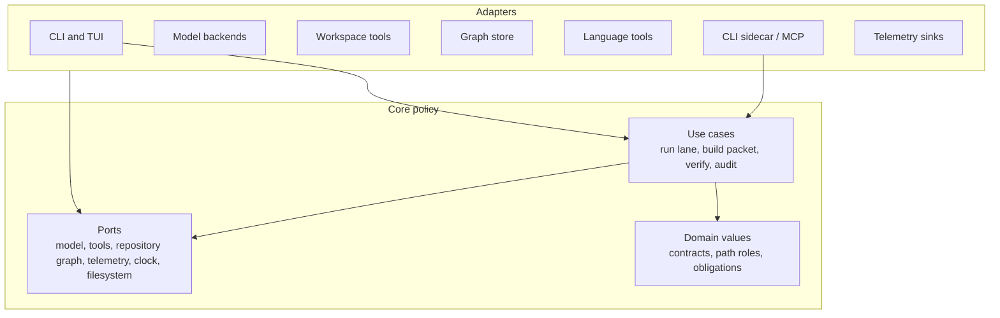

---
tags:
  - idiom
  - implementation-plan
  - architecture
  - rebuild-blueprint
---

# Ground-Up Implementation Plan

This note is the rebuild blueprint for a new Idiom-style project. It describes
the individual implementation efforts, architecture patterns, test strategy,
and quality gates needed to recreate the harness without copying incidental
structure from this repository.

The blueprint is intentionally contract-first:

- The model owns strategy.
- The harness owns contracts.

The goal is not to build another chat UI first. The goal is to build the local
substrate that makes agent work inspectable: repository memory, freshness,
permissions, typed tools, verification, audit, evals, and reusable sidecar
surfaces.

## Product Slice

The first credible product slice should let a user run one local command against
a real repository and receive:

- A fresh repository context packet with ranked files, symbols, tests, and
  uncertainty.
- A tool schema and permission manifest that external agents can consume.
- A read-only audit/status report showing graph freshness, tool availability,
  and privacy-safe evidence.
- One write-capable lane that can edit scoped files, verify the result, and
  produce a final answer or typed blocker.
- Durable telemetry that can explain what happened without raw prompt or file
  body leakage.

Build the system in vertical slices around these outcomes. Avoid spending early
cycles on polish, dashboards, or a large TUI before the contract and evidence
substrate works from the CLI.

## Architecture Pattern

Use Clean Architecture with ports and adapters. The core application should not
depend on model SDKs, terminal UI libraries, SQLite drivers, language-server
clients, MCP libraries, shell commands, or vendor APIs.



Core rules:

- Define use cases before adapters: `RunImplementLane`, `BuildContextPacket`,
  `VerifyChangedPaths`, `EvaluateReadiness`, `ExportToolSchemas`,
  `AuditHarnessState`.
- Keep domain values small and explicit: `PathRole`, `ToolProfile`,
  `Obligation`, `EvidenceRef`, `FreshnessState`, `ReadinessState`,
  `ArtifactState`.
- Make ports narrow. A model port should exchange messages and tool calls, not
  expose provider-specific clients. A graph port should return facts and
  provenance, not raw SQL rows.
- Put composition in one outer layer. Use cases receive ports; they do not
  construct SQLite connections, shell runners, model clients, or telemetry
  writers.
- Treat prompts as interface text. Stable invariants belong in schemas, gates,
  state machines, tests, and telemetry.

Recommended patterns:

| Pattern | Use it for | Avoid |
| --- | --- | --- |
| Ports and adapters | Model backends, filesystem, graph store, language tools, MCP, shell | Importing vendor/client types into use cases |
| State machines | Lane phases, artifact intake, recovery packets, readiness | Inferring terminal state from prose |
| Strategy registry | Capability adapter selection and model backend roles | Prompting the model to choose low-level backend names |
| Repository/gateway | Graph persistence, ranker state, workflow artifacts | Passing SQL rows or file paths as domain policy |
| Event log | Telemetry, audit correlation, recovery evidence | Raw transcript-only diagnosis |
| Value objects | Paths, roles, freshness, permissions, obligations | Magic strings spread across prompts and handlers |
| Contract tests | Tool schemas, sidecar envelopes, lane phase permissions | Snapshot-only tests of long prose |

## Suggested Package Shape

Prefer package names that describe domain responsibility instead of generic
technical buckets. A fresh project can start with this shape and split packages
only when the public contract becomes stable.

| Area | Example package | Owns | Must not own |
| --- | --- | --- | --- |
| Domain contracts | `internal/contract` | Path roles, tool profiles, obligations, readiness states, artifact states | Filesystem or model clients |
| Application use cases | `internal/usecase` | Lane orchestration, context packet building, verification coordination, audit export | CLI formatting or SQL |
| Ports | `internal/port` | Interfaces for model, graph, telemetry, filesystem, clock, shell, language tools | Adapter implementation details |
| Workspace tools | `internal/workspace` | Tool registry, schema export, dispatch, permissions, normalized tool results | Model strategy |
| Repository memory | `internal/memory` | Graph indexing, packets, freshness, views, ranker evidence | Prompt assembly |
| Runner | `internal/runner` | Model loop, tool-call parsing, redirects, readiness gate integration | Backend-specific SDK logic |
| Lane adapters | `internal/lane` | `implement`, `plan-execute`, artifact intake, recovery integration | Domain state names duplicated from `contract` |
| Telemetry and audit | `internal/evidence` | Redacted events, audit summaries, eval fixtures, product/release evidence | Raw private content export |
| Model adapters | `internal/model` | Local and hosted backend clients behind the model port | Tool permissions or readiness rules |
| CLI surface | `cmd/idiom` | Flags, command wiring, output formatting, composition root | Business rules |
| Integration adapters | `internal/sidecar`, `internal/mcp` | CLI tool envelope, MCP transport, profile filtering through shared tools | Separate tool implementation |

The exact names can change, but the ownership must not blur. If a package
starts importing both terminal UI code and graph persistence, split the use case
from the adapter.

## Implementation Efforts

Build each effort with an explicit use case, boundary contract, tests, and
operator command before moving on.

| ID | Effort | Outcome | Primary tests |
| --- | --- | --- | --- |
| E00 | Project skeleton | Go module, CLI entrypoint, config loading, build/test scripts, docs skeleton | `go test ./...`, CLI version smoke |
| E01 | Domain contracts | Types for path roles, tool profiles, obligations, evidence refs, freshness, readiness, artifact states | Pure unit tests for state transitions and validation |
| E02 | Telemetry substrate | Redacted event writer with command IDs, session IDs, correlation IDs, and bounded summaries | Event schema tests, forbidden-marker redaction tests |
| E03 | Tool schema registry | Machine-readable schemas, side-effect metadata, profile filtering, schema export | Schema golden tests, strict JSON validation |
| E04 | Workspace manager | Dispatch gate for read/search/write/shell tools with path-role enforcement | Permission tests, protected-path denial tests, dirty-worktree tests |
| E05 | Model backend port | Provider-neutral message/tool-call protocol plus local and hosted adapters | Fake-model runner tests, backend config tests |
| E06 | Runner loop | Tool-call parsing, tool dispatch, result feedback, final attempts, loop fuses | Runner unit tests with scripted model turns |
| E07 | Readiness and completion | Harness-computed readiness from obligations, mutations, evidence, and verification | Unsupported-final rejection tests, blocker terminal tests |
| E08 | Verification tools | `source_sanity`, command verification records, post-write proof classification | Source-sanity tests, command-result parsing tests |
| E09 | Repository index | Collect files, packages, symbols, imports, tests, calls, diagnostics, fingerprints | Graph fixture tests, collector fallback tests |
| E10 | Freshness and cache | Scoped freshness checks, read-through repair, content-addressed view cache | Cache hit/miss tests, stale-source invalidation tests |
| E11 | Context packet use case | `context_pack`, `context_query`, `context_zoom`, impact, trace attachment | Ranked packet fixture tests, provenance/freshness tests |
| E12 | Capability resolver | Map task-level capabilities to graph, language, structural, shell, or fallback adapters | Adapter selection tests, degraded-mode tests |
| E13 | Implement lane | Write-capable lane with context preload, scoped tools, verification, readiness closeout | End-to-end fake-model lane tests |
| E14 | Plan-execute lane | Read-only planner, typed plan artifact, executor validation, edit dispatch, review-repair | Planner permission tests, executor scope/anchor tests |
| E15 | Artifact intake | Classify dispatchable, source-satisfied, stale, dirty, missing-scope, complete, failed-refine | Artifact-state table tests |
| E16 | Recovery | Failure records, decomposition packets, promote/status/reconcile commands | Recovery packet tests, reconciliation proof tests |
| E17 | Audit and eval | Harness audit, behavior classifiers, replay fixtures, regression evals | Eval fixture tests, audit correlation tests |
| E18 | Ranker learning | Evidence-only learning log, manual boost/penalize, rollback, audit summary | Ranker update tests, no-op evidence tests |
| E19 | Sidecar CLI | `tool list/help/schemas/<name>` with stable envelope and profile permissions | CLI contract tests, external-agent smoke |
| E20 | Inbound MCP* | Discovery-profile MCP server sharing schemas, permissions, telemetry, and freshness | Protocol tests, profile denial tests |
| E21 | Local model ops | Doctor, backend start/stop/status, route roles, queue admission, degraded mode | Doctor fixture tests, queue admission tests |
| E22 | Product workflow* | Evidence to PRD, ADR, TDD obligations, coverage gate, dispatch-ready briefs | Workflow transition tests, coverage-gate tests |
| E23 | TUI/operator surface* | Read-only presenters first, write actions only after CLI contracts are stable | Presenter tests, parity tests against CLI state |
| E24 | Packaging and release | Installer, release evidence, product-evidence export, docs, support boundary | Release smoke, metadata-only evidence tests |

`*` marks efforts that can be roadmapped after the first CLI sidecar and
write-capable lane prove the substrate.

## Recommended Sequence

### Phase 0: Foundation

Ship E00 through E04 first. This creates the repo, contract vocabulary,
redacted telemetry, tool schemas, and workspace permission boundary.

Done when:

- `go test ./...` passes.
- `idiom version`, `idiom tool schemas`, and a read-only file tool work.
- Protected paths and denied profiles fail closed.
- Telemetry records command IDs and redacted summaries only.

### Phase 1: Model Loop

Ship E05 through E08. Use fake model adapters before real model backends so the
runner loop can be tested deterministically.

Done when:

- Scripted model tests cover valid tool calls, invalid tool calls, no-tools
  fallback, repeated-loop redirects, final attempts, and blockers.
- Writes require scoped permission.
- Post-write verification is recorded before readiness can close.

### Phase 2: Repository Memory

Ship E09 through E12. Start with Go and generic collectors, but keep the graph
and capability contracts language-neutral.

Done when:

- `context_index` builds a graph for a fixture repo.
- `context_status` reports freshness and collector coverage.
- `context_pack` returns ranked candidates, tests, provenance, freshness, and
  unresolved gaps.
- Cache validation refuses stale referenced-source fingerprints.

### Phase 3: Lanes

Ship E13 through E16. Prefer one robust `implement` lane before `plan-execute`;
then add typed plan artifacts and executor validation.

Done when:

- `implement` can complete a bounded fake-model edit with verification.
- `plan-execute` prevents planner writes and rejects stale or out-of-scope
  executor plans.
- Artifact intake blocks stale, dirty, complete, and source-satisfied work
  before model tokens are spent.
- Recovery packets can be inspected, promoted, and reconciled without raw
  transcript leakage.

### Phase 4: Audit, Eval, And Sidecar

Ship E17 through E20. Make the sidecar reuse the same workspace manager and
schemas; do not build a second tool system for integrations.

Done when:

- `harness_audit` can diagnose tool surface, freshness, readiness, and repeated
  loop issues from structured artifacts.
- Eval fixtures catch at least one known bad behavior per contract family.
- `idiom tool context_pack --input ...` returns the stable sidecar envelope.
- MCP exposes only the intended read-only discovery profile if enabled.

### Phase 5: Operations And Product Workflow

Ship E21 through E24 after the substrate is useful from the CLI.

Done when:

- `doctor` reports backend, model, graph, sidecar, eval, and privacy readiness.
- Queue admission prevents local-model capacity failures from becoming
  confusing lane failures.
- Product evidence and release evidence are metadata-only by default.
- Docs explain current behavior separately from roadmapped behavior.

## DRY And Boundary Rules

Remove duplicated knowledge, not merely duplicated text.

Centralize:

- Path-role and permission checks in the workspace/autonomy boundary.
- Tool schemas and side-effect metadata in one registry.
- Artifact state names and transition rules in one domain package.
- Readiness and completion rules in one gate.
- Freshness rules in the graph/memory boundary.
- Telemetry redaction rules in one event pipeline.
- Prompt assembly rules in one prompt stack.

Do not centralize:

- Coincidentally similar adapter code before the stable port is clear.
- One-off command formatting that belongs at a surface.
- Prompt examples that are only useful for one lane.
- Test fixtures so aggressively that each test stops saying what behavior it
  protects.

The review question is: "Which concept owns this rule?" If two packages can
change the same rule independently, the design is not DRY.

## Testing Strategy

Use tests as living contracts. Favor small deterministic tests around domain
states, use cases, schemas, and ports, then add integration tests where
adapters meet real files, processes, SQLite, or protocol transports.

| Test layer | Purpose | Tooling |
| --- | --- | --- |
| Domain unit tests | Path roles, artifact states, readiness, freshness, obligations | `go test`, table tests |
| Use-case tests | Runner loop, context packet building, lane transitions | Fake model, fake graph, fake telemetry |
| Contract/schema tests | Tool schemas, sidecar envelope, plan artifacts, telemetry events | Golden JSON plus strict decode |
| Adapter tests | Filesystem, shell, SQLite graph, language tools, MCP | Temp dirs, fixture repos, fake servers |
| CLI smoke tests | Operator command behavior and exit codes | `go test` around command helpers |
| Security/privacy tests | Protected paths, redaction, raw-content exclusion | Forbidden-marker fixtures |
| Eval tests | Behavioral regressions and audit classification | JSONL fixtures and replay harness |
| Docs checks | Obsidian links, roadmap markers, whitespace | `git diff --check`, focused link scripts* |

Coverage expectations:

- Every state machine transition has table coverage.
- Every profile-sensitive tool has allow and deny tests.
- Every write path has protected-path and outside-root tests.
- Every durable JSON artifact has schema-version and strict decode tests.
- Every behavioral harness fix adds a regression test for the bad behavior and
  a valid path that remains allowed.
- Every privacy/export feature has a forbidden-marker test proving raw prompts,
  raw transcript bodies, secrets, and raw file bodies are excluded by default.

Default verification:

```bash
go test ./...
git diff --check
```

Add these when relevant:

```bash
go test ./internal/agent ./internal/workspace ./internal/comprehension
go test ./cmd/idiom
go build ./cmd/idiom
idiom tool context_status --input '{"refresh":true,"limit":50}'
idiom tool harness_audit --input '{"purpose":"behavior"}'
```

## Data And Artifact Contracts

Use explicit schema versions for every durable artifact:

- Tool schema export.
- Sidecar tool result envelope.
- Telemetry events.
- Context packet and graph view.
- Plan artifact.
- Recovery packet.
- Ranker learning event.
- Product and release evidence exports.

Each artifact should include:

- Schema version.
- Workspace-relative path references where possible.
- Correlation IDs.
- Freshness or source fingerprint where relevant.
- Evidence refs instead of raw bodies.
- Redaction policy or privacy boundary when externally shareable.
- Unknown-field behavior: reject for control artifacts, tolerate only for
  forward-compatible metadata where explicitly intended.

## Feature Acceptance Gates

A feature is not complete because a model can do it once. It is complete when
the harness can explain, test, and replay the behavior.

| Feature family | Acceptance gate |
| --- | --- |
| Workspace tool | Schema exported, permission tests pass, telemetry event emitted, sidecar call works |
| Context memory | Freshness visible, stale state not served as fresh, provenance and uncertainty included |
| Lane behavior | Phase tools correct, required paths enforced, verification recorded, final gate tested |
| Prompt change | Canonical owner identified, no duplicate authority, behavior test or eval protects it |
| Audit classifier | Replays from structured logs, avoids raw private content, has positive and negative fixtures |
| Sidecar/MCP | Reuses workspace manager, profile filtering, schemas, telemetry, and permission gates |
| Recovery | Failure record written, packet inspectable, promotion scoped, reconciliation evidence validated |
| Product evidence | Metadata-only by default, forbidden-marker tests pass, claims linked to commands or artifacts |

## Anti-Patterns To Avoid

- Building a TUI before the CLI contracts are trustworthy.
- Letting prompt prose enforce permissions, freshness, verification, or
  completion.
- Adding many language-specific tools without a capability vocabulary.
- Returning raw file floods where a packet with provenance and uncertainty
  would be better.
- Treating context packet paths as write authority.
- Treating patch hygiene as source verification.
- Allowing external integrations to bypass the first-party workspace manager.
- Logging raw prompts, transcript excerpts, or file bodies into durable
  shareable artifacts.
- Creating generic `helpers` or `common` packages for rules that have a real
  domain owner.

## Source Notes In This Vault

Use these notes as the implementation map:

- [[01 - System Map]] for the full system shape.
- [[02 - Deterministic Evidence-Based Development]] for the working discipline.
- [[03 - Architecture Layers]] for dependency direction.
- [[04 - Runtime Lanes]] for lane behavior.
- [[05 - Runner Contracts and Control Rails]] for model-loop contracts.
- [[06 - Workspace Tools and Capability Routing]] for tool boundaries.
- [[07 - Repository Memory and Context Graph]] for memory and freshness.
- [[08 - Planning Packets and Handoff]] for plan-execute artifacts.
- [[09 - Verification Readiness and Completion]] for completion gates.
- [[10 - Telemetry Audit Eval and Learning]] for improvement loops.
- [[12 - Sidecar and External Integrations]] for reusable substrate surfaces.
- [[17 - Security Privacy and Data Boundaries]] for export and redaction rules.
