# ROADMAP: Product Workflow and TDD Coverage

> **Status: ROADMAP** — Tracks what is done and what remains for the upstream
> product pipeline and behavioral TDD coverage. Last audited 2026-05-18 against
> the codebase and the durable effort state under
> `docs/product-workflows/efforts/started/prd-adr-brief-workflow/`.
>
> Design docs:
> [design-prd-adr-brief-research-workflow.md](../design-prd-adr-brief-research-workflow.md),
> [design-tdd-coverage.md](../design-tdd-coverage.md)

## DONE: Seven Pillars

All seven architectural pillars have substantial, production-quality
implementations.

| Pillar | Design Doc | Status | Key Evidence |
| --- | --- | --- | --- |
| Contract-first autonomy | [design-contract-first-local-autonomy.md](../design-contract-first-local-autonomy.md) | **DONE** | `internal/autonomy/contract.go` — full `AutonomyContract` struct with obligations, path roles, gates; `audit.go` with obligation/gate/policy coverage |
| Persistent repository memory | [design-persistent-repository-memory.md](../design-persistent-repository-memory.md) | **DONE** | `internal/comprehension/` — 20+ files: graph SQLite, content-addressed caching, ranker learning, freshness, incremental rebuild |
| Capability-oriented tooling | [design-capability-oriented-tooling.md](../design-capability-oriented-tooling.md) | **DONE** | `internal/workspace/capabilities.go` — `ReadOnlyCapabilityRegistry`, language-aware adapter routing |
| Auditable planning/handoff | [design-auditable-planning-handoff.md](../design-auditable-planning-handoff.md) | **DONE** | `internal/architect/` — packet schemas, plan audit; `cmd/idiom/plan_execute.go`; `submit_plan` tool with artifact schema |
| Local model operations | [design-local-model-operations.md](../design-local-model-operations.md) | **DONE** | `internal/llama/` — client, server controller; `cmd/idiom/queue.go` — Unix socket queue daemon; multi-model support |
| Eval/audit/learning flywheel | [design-eval-audit-learning-flywheel.md](../design-eval-audit-learning-flywheel.md) | **DONE** | `internal/eval/` — 17 files: SWE-bench, localization benchmark, groundedness, ranker learning; `product_evidence.go`, `release_evidence.go` |
| Sidecar/substrate | [design-agent-substrate-sidecar.md](../design-agent-substrate-sidecar.md) | **DONE** | `internal/mcp/` — client, registry, HTTP transport, SSRF protection; `tool_sidecar_envelope.go`; autonomy sidecar integration |

## DONE: Existing Infrastructure Reused By Pipeline

These are complete and the product workflow composes them without modification.

| Capability | Status | Package |
| --- | --- | --- |
| `context_pack` / `context_query` / `context_zoom` | **DONE** | `internal/comprehension/` |
| `context_impact` / `context_trace_pack` | **DONE** | `internal/comprehension/` |
| `harness_audit` tool | **DONE** | `internal/workspace/harness_audit.go` |
| Architect packet generation | **DONE** | `internal/architect/packet.go` |
| Plan audit | **DONE** | `internal/architect/plan_audit.go` |
| Brief lint (preflight) | **DONE** | `cmd/idiom/brief-preflight.py`, `cmd/idiom/brief.go` |
| Atom intake | **DONE** | `cmd/idiom/atom.go` |
| Lane dispatch (`implement`, `plan-execute`) | **DONE** | `cmd/idiom/` |
| Product evidence export | **DONE** | `cmd/idiom/product_evidence.go` |
| Release evidence aggregation | **DONE** | `cmd/idiom/release_evidence.go` |
| Localization benchmark | **DONE** | `internal/eval/localization_benchmark.go` |
| SWE-bench eval infrastructure | **DONE** | `internal/eval/swe_suite.go` |

## IN PROGRESS: PRD/ADR/Brief Workflow

The design doc exists at
[design-prd-adr-brief-research-workflow.md](../design-prd-adr-brief-research-workflow.md).
See [[20 - PRD ADR Brief Research Workflow PROPOSAL]] for the Obsidian summary.
Implementation is active and source-controlled through the durable effort folder.
As of Atom 30 closeout, deterministic schemas, product lint/audit/status,
research profile planning/merge/prompt rendering, PRD/ADR prompt rendering,
acceptance metadata validation, ADR supersession link validation, plan-only TDD
obligation synthesis, tiered coverage-gate evaluation, lint-verified brief
generation, read-only execution feedback linking, durable feedback
reconciliation, and product-workflow metrics in product audit/status exist. The
next design-doc slice is Obsidian parity enforcement.

### Schemas and Types

- [x] Evidence card schema struct and validator
- [x] Evidence ledger merge from researcher output cards, with conflict
  preservation and freshness/unsupported-claim policy handling
- [x] Research profile schema struct and project-local profile discovery
- [x] PRD schema struct with requirement shape
- [x] ADR schema struct with Nygard-format fields, acceptance metadata, and
  supersession links
- [x] TDD obligation ledger schema v1/v2 support with coverage metadata
- [x] Traceability matrix linking evidence → PRD → ADR → TDD → brief
- [x] Artifact state enum (draft/audited/accepted/blocked/dispatched)

### Deterministic Audit Commands

- [x] PRD audit: schema validation, evidence reference existence, metric
  presence, TDD obligation references, parse failures, and privacy-safe durable
  reports
- [x] ADR audit: completeness checks, PRD/evidence/TDD link validation,
  supersession chain validation, alternative presence, consequence fields, and
  required acceptance metadata for accepted artifacts
- [x] TDD obligation audit: high-priority requirement coverage and current plus
  historical obligation reference checks
- [x] Coverage gate: deterministic tiered threshold check (see below)
  - [ ] Reuse product lint/audit traceability, acceptance, and supersession
    validators, or run them as blocking coverage-gate preconditions
- [x] Brief generation: deterministic template filling from PRD/ADR/TDD
  artifacts, section ordering, ID injection

### Research Infrastructure

- [x] Researcher role configuration from profiles
- [ ] `tdd_eval` researcher role with FMEA/HAZOP evidence sources
- [x] Deterministic evidence merge from stored researcher outputs, with explicit
  profile selection and conflict preservation
- [x] Research profile storage under `.idiom/research/profiles/`
- [x] Plan-only research run specs from stored profiles
- [x] Role-specific research artifact prompt rendering via `idiom artifact
  --no-tools` command recipes

### CLI Commands

- [x] `idiom product status` — summarize durable workflow state, gates, blockers,
  and next valid actions
- [x] `idiom product research` — inspect profiles, plan research runs, merge
  existing researcher outputs, and render prompt files without executing models
- [x] `idiom product prd --render-prompt` — render deterministic PRD prompt from
  the evidence ledger without drafting or accepting the PRD
- [x] `idiom product adr --render-prompt` — render deterministic ADR prompt from
  the evidence ledger plus parsed PRD without drafting or accepting ADRs
- [x] `idiom product tdd --plan-obligations` — build a deterministic,
  plan-only obligation plan from accepted PRD requirements and accepted ADRs
- [x] `idiom product tdd --evaluate-coverage` — evaluate tiered coverage
  criteria from accepted PRD/ADR/TDD artifacts without generating briefs
- [x] `idiom product brief` — generate briefs from PRD + ADRs + TDD
- [x] `idiom product feedback` — summarize explicit lane/progress/evidence
  references without dispatching lanes or mutating `.idiom` runtime state
- [x] `idiom product lint` — validate durable effort artifacts and cross-links
- [x] `idiom product audit` — sectioned audit over the product workflow directory

### Telemetry and Durable Events

- [x] Durable workflow events for atom planning, implementor assignment,
  implementation completion, verification, review, investigation, atom closeout,
  and workflow-state updates
- [x] Evidence merge and prompt-rendering behavior is represented in durable
  reports and implementation ledger records
- [ ] Runtime telemetry events: `research_packet_created`, `researcher_started`,
  `researcher_completed`
- [ ] Runtime telemetry events: `evidence_card_recorded`,
  `evidence_conflict_recorded`
- [ ] Runtime telemetry events: `prd_drafted`, `prd_audited`
- [ ] Runtime telemetry events: `adr_drafted`, `adr_accepted`
- [x] Durable event/report records for TDD obligation synthesis planning
- [ ] Runtime telemetry event: `tdd_obligations_created`
- [x] Durable coverage-gate evaluation evidence in implementation reports
- [ ] Runtime telemetry event: `coverage_gate_evaluated`
- [x] Durable brief-generation evidence in implementation reports
- [ ] `product_artifact_dispatch_ready`, `product_artifact_blocked`
- [x] Read-only execution feedback summary from explicit lane/progress/evidence
  references
- [x] Durable feedback reconciliation from passing summary into
  workflow-state/evidence links
- [x] Durable `execution_result_linked` reconciliation into workflow state and
  evidence links
- [x] Product-workflow metrics in product audit/status
- [ ] Obsidian parity check in product lint/audit or closeout reporting

## NOT STARTED: Behavioral TDD Coverage Pipeline

The design doc exists at [design-tdd-coverage.md](../design-tdd-coverage.md).
See [[21 - Behavioral TDD Coverage PROPOSAL]] for the Obsidian summary.
Zero implementation code exists.

### TODO: Stage 1-4 (Requirements to Contracts)

- [ ] EARS template parser and validator
- [ ] EARS-to-BDD mapping (5 pattern templates)
- [ ] Example mapping schema (story → rules → examples → questions)
- [ ] BDD/Gherkin scenario validator
- [ ] Design by Contract schema (precondition/postcondition/invariant per port)
- [ ] BDD Then → postcondition binding validation
- [ ] BDD Given → precondition binding validation

### TODO: Stage 5 (Failure Mode Analysis — ~80% Deterministic)

- [ ] FMEA template: 5 failure classes, Severity/Probability/Detection scoring
- [ ] FMEA RPN calculator and threshold filter (RPN >= 21 → mandatory test)
- [ ] FMEA negative test obligation generator
- [ ] HAZOP guide-word checklist (11 guide words)
- [ ] HAZOP guide-word applicator per workflow step
- [ ] HAZOP severity filter (severity >= 3 → mandatory test)
- [ ] HAZOP deviation test obligation generator
- [ ] FTA tree schema (AND/OR gates, basic events)
- [ ] FTA leaf-to-obligation generator

### TODO: Stage 6-7 (State Machine and Test Suite)

- [ ] State machine model schema (states, transitions, guards, invariants)
- [ ] Reachability and deadlock checks
- [ ] Decision table enumerators (2^n boolean combinations)
- [ ] Boundary value generators (numeric bounds extraction and test values)
- [ ] PBT obligation schema (invariant, state machine, min cases, shrink)
- [ ] Decision table obligation schema
- [ ] Approval test fixture schema (transcript capture, structural comparison)

### TODO: Stage 8-9 (Mutation and Coverage Gate — 100% Deterministic)

- [ ] Mutation operator registry for contract fields
- [ ] Mutation test executor and score calculator
- [ ] Mutation score threshold gate (>= 80%)
- [ ] Coverage gate: 9-criterion deterministic checker
- [ ] Coverage gate event emission (`coverage_gate_evaluated`)
- [ ] Coverage gate block routing (which upstream stage to return to)

### TODO: Feedback Loop

- [ ] Post-mortem obligation template (incident → root cause → catching test)
- [ ] Incident-to-FMEA feedback (new failure mode from execution)
- [ ] Incident-to-HAZOP feedback (new deviation from execution)
- [ ] Coverage gate metric updates from execution outcomes
- [ ] Spec-compliance evaluation (independent of functional correctness)

## TODO: Implementation Phases

All implementation phases must be executed as long-lived implementation atoms.
Each atom requires a complexity-tier assessment, a GPT Codex implementor selected
to match the atom complexity, one distinct GPT reviewer sub-agent, required
verification, and a post-effort investigation report before closeout. Persist
atom state in the effort folder so work can resume across sessions without
relying on raw transcript replay. Historical DS4/GLM/OpenCode attempts remain
audit evidence only unless a human explicitly re-authorizes them.

### TODO: Long-Lived Implementation Operating Model

- [x] Implementation atom schema with `task_id`, phase, state, complexity tier,
  blast radius, context pack ID, expected files, forbidden files, TDD
  obligations, required tests, and blockers
- [x] Implementor assignment fields: agent ID, runtime, model, command,
  discovery evidence, and selection reason
- [x] Reviewer assignment fields: distinct agent ID, GPT model, reasoning
  effort, selection reason, and reviewer independence check
- [x] Complexity tiers `C0` through `C4` with economic model/effort defaults
  and upgrade/downgrade justification
- [x] GPT Codex implementor policy recorded in effort README; DS4/GLM/OpenCode
  lanes are historical evidence, not the active implementor default
- [x] Append-only `implementation_ledger.jsonl` in each effort folder
- [x] Per-atom implementation, review, and post-effort investigation reports
- [x] Resume validation that loads workflow state, implementation ledger, latest
  reports, event log, context freshness, and git status before choosing the next
  action
- [x] Closeout blocker when model/effort selection is missing, implementor and
  reviewer are the same actor, required verification is missing, or the
  post-effort investigation is incomplete
- [x] Per-atom changed-path scope gate and per-commit coverage validation
- [x] Atom planning and closeout pattern includes commit and push after each
  atom/checkpoint

### Phase 0: Design Fixtures

- [x] PRD/ADR/brief workflow design doc
- [x] Behavioral TDD coverage design doc
- [x] Obsidian PROPOSAL and ROADMAP notes
- [x] Example PRD, ADR, TDD ledger, brief, evidence ledger, traceability matrix,
  and reports under the durable effort folder
- [x] Manual walkthrough using current `context_pack`, product lint/audit/status,
  JSON/JSONL validation, privacy scan, and git diff checks
- [x] Seed the implementation ledger with a `C0` documentation/fixture atom and
  persist implementor/reviewer assignments, reports, and post-effort
  investigation evidence

### Phase 1: Schemas and Deterministic Linters

- [x] Evidence card, PRD, ADR, TDD obligation structs
- [x] Implementation atom, complexity tier, assignment, and investigation report
  structs
- [x] PRD audit, ADR audit, TDD audit deterministic commands
- [x] Source-controlled durable effort storage under `docs/product-workflows/`
- [ ] Working artifact storage under `.idiom/product/`
- [x] Tests for schema validation and gate logic
- [x] Tests for assignment independence, missing model/effort selection,
  incomplete investigation report, and cross-session resume blockers

### Phase 2: Research Profiles

- [x] Researcher role configuration from profiles
- [ ] `tdd_eval` role with FMEA/HAZOP templates
- [x] Deterministic evidence merge
- [x] Profile storage under `.idiom/research/profiles/`
- [x] Plan-only research run specs
- [x] Research artifact prompt rendering without model execution

### Phase 3: PRD and ADR Generation

- [x] PRD prompt renderer from evidence ledger
- [x] ADR prompt renderer from PRD
- [x] Acceptance state and supersession links
- [ ] Durable two-ADR supersession fixture covering markdown front matter, ADR
  index metadata, audit output, and workflow status
- [ ] Explicit index-vs-markdown divergence policy for ADR supersession metadata,
  with fail-closed tests until the authority rule is encoded
- [ ] Human acceptance flow

### Phase 4: TDD Planner and Coverage Gate

- [x] Deterministic TDD obligation synthesis plan from accepted PRD/ADR artifacts
- [ ] EARS template parser and validator
- [ ] FMEA template and RPN scorer
- [ ] HAZOP guide-word applicator
- [ ] Decision table and boundary value enumerators
- [ ] PBT obligation schema
- [x] Coverage gate evaluator (tiered criteria, deterministic)
  - [ ] Gate fails when canonical lint/audit cross-link, acceptance, or
    supersession validation fails
- [x] Brief generator with coverage gate dependency

### Phase 5: Mutation Testing and Verification

- [ ] Mutation operator registry
- [ ] Mutation score calculator
- [ ] Mutation score gate (>= 80%)
- [ ] Spec-compliance evaluation

### Phase 6: Execution Feedback Loop

- [x] Read-only lane/progress/evidence reference summary
- [ ] Durable lane event → PRD/ADR/TDD obligation linking
- [ ] Post-mortem obligation auto-generation
- [ ] Incident → FMEA/HAZOP feedback
- [ ] Coverage metric updates from outcomes
- [ ] Obsidian parity lint/audit or closeout check for stale proposal/roadmap
  status, with explicit no-change rationale support
- [ ] Human-readable CLI output tests for each operator-facing product command,
  including actionable failure text and next valid action

### Phase 7: Sidecar and External Agent Use

- [ ] Read-only product workflow commands via `idiom tool` and MCP
- [ ] External agent consumption of PRD/ADR/brief artifacts
- [ ] Write authorization remains in existing lane contracts

## Deterministic vs LLM Architecture

~75% of the pipeline can be deterministic tooling. The LLM is needed at
roughly 5 narrow synthesis points. Every LLM output immediately re-enters
deterministic validation. The LLM never skips a gate.

```mermaid
flowchart LR
    subgraph Deterministic
        D1[Intake classify]
        D2[Packet build]
        D3[Evidence gather]
        D4[Evidence merge]
        D5[PRD audit]
        D6[ADR audit]
        D7[EARS validate]
        D8[FMEA enumerate]
        D9[HAZOP apply]
        D10[Decision tables]
        D11[Boundary values]
        D12[Coverage gate]
        D13[Brief lint]
        D14[Atom intake]
    end
    subgraph LLM Synthesis
        L1[Interpret evidence]
        L2[Draft PRD prose]
        L3[Draft ADR prose]
        L4[Rate FMEA severity]
        L5[Write brief guidance]
    end
    D1 --> D2 --> D3 --> L1 --> D4 --> L2 --> D5
    D5 --> L3 --> D6 --> D7 --> D8 --> L4 --> D9 --> D10 --> D11 --> D12
    D12 --> L5 --> D13 --> D14
```

## Related Notes

- [[01 - System Map]]
- [[02 - Deterministic Evidence-Based Development]]
- [[05 - Runner Contracts and Control Rails]]
- [[08 - Planning Packets and Handoff]]
- [[09 - Verification Readiness and Completion]]
- [[10 - Telemetry Audit Eval and Learning]]
- [[20 - PRD ADR Brief Research Workflow PROPOSAL]]
- [[21 - Behavioral TDD Coverage PROPOSAL]]
