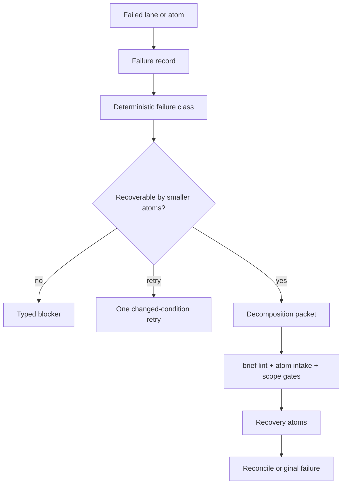

# PROPOSAL: Decompose On Failure

> **Status: TARGET DESIGN** — Idiom has pre-dispatch atomization/refine behavior
> and one planner-blocked retry-or-surface path, but it does not yet have a
> durable workflow that turns a failed run into classified failure evidence,
> smaller gated recovery atoms, and reconciliation back to the original failed
> atom.
>
> Source: [design-decompose-on-failure.md](../design-decompose-on-failure.md)

## What This Proposes

A recovery layer that converts failed implementation runs into durable,
reviewable follow-up work instead of unbounded retries or manual splitting.

```text
failed run -> failure record -> failure class -> decomposition packet
-> gated recovery atoms -> reconciliation
```

## Current Adjacent Behavior

- [x] Brief lint can report single-purpose decomposition or atom-size blockers.
- [x] TUI/prompt implementation dispatch can pre-atomize broad design docs
  before `plan-execute`.
- [x] TUI/prompt implementation dispatch can refine non-dispatchable briefs
  before `plan-execute`.
- [x] Plan-execute records planner-blocked and missing-plan failure state.
- [x] Planner-blocked recovery can choose one retry or surface to the human.
- [ ] Failed runs are not yet converted into durable decomposition packets.
- [ ] Smaller recovery atoms are not yet synthesized from failure evidence.
- [ ] Recovery atoms are not yet promoted through a dedicated gate and linked
  back to the original failure.

## Target Lifecycle



## Failure Classes

| Class | Expected action |
| --- | --- |
| `scope_too_large` | Decompose into smaller atoms |
| `planner_blocked` | Retry once only when conditions changed; otherwise surface |
| `plan_missing` | Retry or decompose depending on evidence |
| `executor_edit_failed` | Diff QC, then decompose or repair |
| `verification_failed` | Decompose by failing test/package/symbol |
| `review_repair_failed` | Decompose remaining findings |
| `stale_context` | Refresh evidence, then retry or decompose |
| `budget_exhausted` | Decompose by output size and path ownership |
| `dirty_workspace` | Block until partial state is classified |
| `needs_human_answer` | Surface typed question |
| `unsafe_policy_block` | Surface blocker; do not decompose |

## Acceptance Shape

- A failed run writes a privacy-safe failure record.
- The classifier emits one root failure class plus evidence tags.
- Decomposition packets list residual work, partial state, candidate atoms,
  required paths, forbidden paths, tests, and next valid action.
- Candidate atoms must pass normal brief lint, atom intake, scope, and product
  workflow gates before dispatch.
- The original failure remains immutable and linked after recovery succeeds.

## Related Notes

- [[02 - Deterministic Evidence-Based Development]]
- [[04 - Runtime Lanes]]
- [[08 - Planning Packets and Handoff]]
- [[09 - Verification Readiness and Completion]]
- [[10 - Telemetry Audit Eval and Learning]]
- [[19 - CLI TUI and Operator Surface]]

