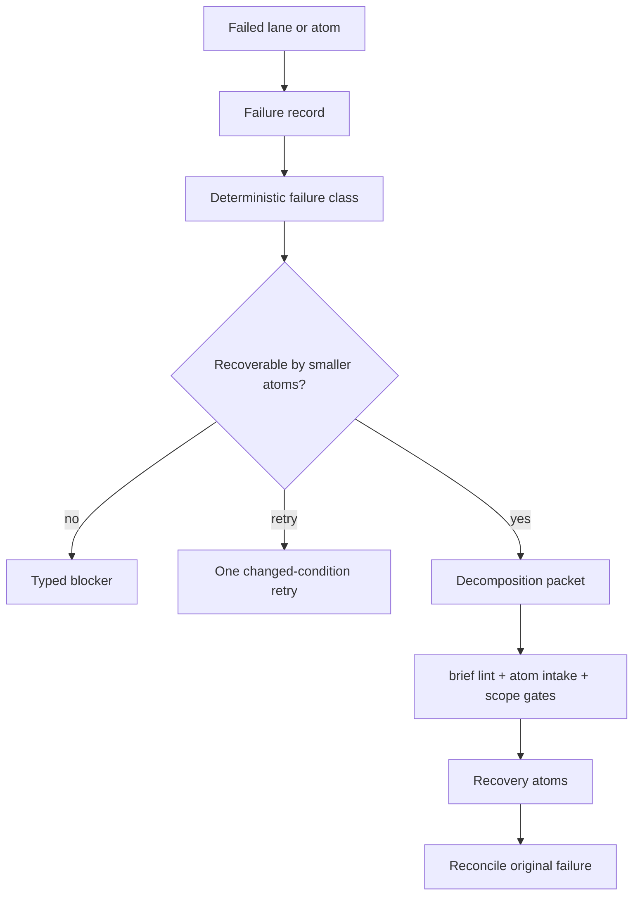

# PROPOSAL: Decompose On Failure

> **Status: PLAN-EXECUTE LOOP LANDED** — Idiom has pre-dispatch
> atomization/refine behavior, one planner-blocked retry-or-surface path, and
> automatic failed `plan-execute` recovery records plus decomposition packets.
> `idiom recover inspect`, `status`, `decompose`, and `promote` provide the
> operator-facing loop. Read-only `recovery_inspect` and `recovery_status` are
> also exposed through `idiom tool`/MCP with the normal sidecar envelope.
> Product/operator status and audit-watch now project bounded recovery state.
> Promotion writes a normal gated brief; it does not dispatch or reconcile the
> original failure automatically yet.
>
> Source: [design-decompose-on-failure.md](../design-decompose-on-failure.md)

## What This Proposes

A recovery layer that converts failed implementation runs into durable,
reviewable follow-up work instead of unbounded retries or manual splitting.

```text
failed run -> failure record -> failure class -> decomposition packet
-> gated recovery atoms -> reconciliation
```

## Current Adjacent Behavior

- [x] Brief lint can report single-purpose decomposition or atom-size blockers.
- [x] TUI/prompt implementation dispatch can pre-atomize broad design docs
  before `plan-execute`.
- [x] TUI/prompt implementation dispatch can refine non-dispatchable briefs
  before `plan-execute`.
- [x] Plan-execute records planner-blocked and missing-plan failure state.
- [x] Failed plan-execute runs write
  `.idiom/recovery/<failure-id>/failure.json` automatically.
- [x] `idiom recover inspect --session <id>` provides read-only JSON/text
  inspection of failure records.
- [x] Planner-blocked recovery can choose one retry or surface to the human.
- [x] Failed plan-execute runs write
  `.idiom/recovery/<failure-id>/packet.json` automatically.
- [x] Smaller candidate recovery atoms are synthesized from required and
  changed path evidence.
- [x] `idiom recover promote` writes a candidate atom brief only after brief
  lint, atom intake, and scope gates pass.
- [x] `idiom tool --profile discovery recovery_inspect` and `recovery_status`
  expose the read-only recovery state; `recovery_decompose` stays out of the
  discovery profile because it writes artifacts.
- [x] `idiom product status --operator-view` surfaces recovery packets from
  `workflow_state.artifact_paths.recovery_packet` and blocks normal dispatch
  while recovery is open.
- [x] `idiom audit watch` emits `failure_recovery` findings and bounded
  recovery summaries for recovery record and decomposition-packet events.
- [ ] Recovery success is not yet reconciled back to the original failure.
- [ ] TUI projections, deeper residual-work evidence, and non-plan-execute
  adapters are not yet complete.

## Target Lifecycle



## Failure Classes

| Class | Expected action |
| --- | --- |
| `scope_too_large` | Decompose into smaller atoms |
| `planner_blocked` | Retry once only when conditions changed; otherwise surface |
| `plan_missing` | Retry or decompose depending on evidence |
| `executor_edit_failed` | Diff QC, then decompose or repair |
| `verification_failed` | Decompose by failing test/package/symbol |
| `review_repair_failed` | Decompose remaining findings |
| `stale_context` | Refresh evidence, then retry or decompose |
| `budget_exhausted` | Decompose by output size and path ownership |
| `dirty_workspace` | Block until partial state is classified |
| `needs_human_answer` | Surface typed question |
| `unsafe_policy_block` | Surface blocker; do not decompose |

## Acceptance Shape

- A failed run writes a privacy-safe failure record.
- The classifier emits one root failure class plus evidence tags.
- Decomposition packets list residual work, partial state, candidate atoms,
  required paths, forbidden paths, tests, and next valid action.
- Candidate atoms must pass normal brief lint, atom intake, scope, and product
  workflow gates before dispatch.
- The original failure remains immutable and linked after recovery succeeds.
- CLI, TUI, product workflow, `idiom tool`, and MCP expose the same read-only
  recovery status model: typed blockers, gates, evidence links,
  dispatchability, and one next valid action.
- Audit-watch review packets include bounded recovery summaries and
  `failure_recovery` findings without raw transcripts.
- Write/promote recovery actions stay out of the sidecar discovery profile until
  a dedicated write-authorization contract exists.

## Tool Parity

Recovery should reuse existing surfaces instead of inventing parallel checks:

| Surface | Role |
| --- | --- |
| `plan-execute`, `implement`, `lane` | source failure records, progress state, events, changed paths |
| `architect`, `artifact` | planning/handoff evidence and optional schema-bound drafting, not authority |
| `brief lint`, `atom intake`, `lane postflight` | promotion gates for recovery atoms |
| `task`, `task_ledger` | operator-visible recovery work items without overriding gates |
| `context_*`, discovery, language tools | capability-backed residual-work evidence |
| workspace read/search/mutation/delegation tools | bounded evidence for reads; mutation remains lane-owned authority |
| `git_status`, `git_diff`, verification commands | partial-state and test-failure evidence |
| `harness_audit`, `audit watch`, evals | recurring failure and recovery coverage |
| product workflow, product evidence, release evidence | effort linkage and external review summaries |
| TUI, `idiom tool`, MCP | shared presenter/read-only status parity |

## North-Star Fit

- The harness owns failure classification, retry budgets, gate enforcement, and
  completion claims.
- The model may propose recovery atom content only inside a host-owned schema.
- Recovery packets describe capabilities and evidence gaps, not
  language-specific tool strategies.
- Same-scope retry requires changed conditions; otherwise the next action is
  decomposition or a human-visible blocker.

## Related Notes

- [[02 - Deterministic Evidence-Based Development]]
- [[04 - Runtime Lanes]]
- [[08 - Planning Packets and Handoff]]
- [[09 - Verification Readiness and Completion]]
- [[10 - Telemetry Audit Eval and Learning]]
- [[19 - CLI TUI and Operator Surface]]
