---
tags:
  - idiom
  - architecture
  - onboarding
  - systems
---

# Major Systems Architectural Onboarding

This note is the subsystem entry map for implementation and review work. Use it
after [[01 - System Map]] and [[13 - Package Guide]] when you need to know where
a change belongs, which boundary owns the contract, and what evidence should
prove the change.

The rule that keeps the map coherent is the repo's north star:

- The model owns strategy.
- The harness owns contracts.

If a change makes the harness choose the model's strategy, move it up to a
contract, tool schema, typed artifact, readiness rule, or evidence surface
instead.

## Onboarding Flow

```mermaid
flowchart LR
    Task["Task or regression"] --> System["Pick the owning system"]
    System --> Contract["Name the contract boundary"]
    Contract --> Sources["Read source anchors and nearby tests"]
    Sources --> Probe["Run the narrowest probe"]
    Probe --> Change["Patch the owning layer"]
    Change --> Verify["Run focused tests and evidence command"]
    Verify --> Full["Escalate to full suite when shared behavior changed"]
```

## System Entry Matrix

| System | Owns | Does not own | First source anchors | Expected proof |
| --- | --- | --- | --- | --- |
| CLI and lanes | Repeatable command entry, lane routing, atom intake | Model-loop policy or tool semantics | `cmd/idiom/main.go`, `internal/rootcmd`, `internal/lanecmd`, `internal/planexecutecmd` | `go test ./internal/rootcmd ./internal/lanecmd ./internal/planexecutecmd` |
| TUI/session lifecycle | Interactive dispatch, session state, operator controls | Core runner contracts | `internal/app`, `cmd/idiom/tui.go` | `go test ./internal/app` |
| Runner and contracts | Model loop, tool-call protocol, readiness, recovery nudges | Tool implementation details | `internal/agent/runner.go`, `internal/agent/runner_autonomy.go` | `go test ./internal/agent` |
| Workspace tools | Tool schemas, permission checks, source sanity, direct tool CLI | Lane policy or model strategy | `internal/workspace/manager.go`, `internal/workspace/tool_schemas.go` | `go test ./internal/workspace` |
| Repository memory | Context graph, freshness, packs, trace packs, ranker inputs | Final-answer readiness | `internal/comprehension`, `internal/discovery` | `go test ./internal/comprehension ./internal/discovery` |
| Planning and handoff | Plan artifacts, `submit_plan`, executor inheritance | Arbitrary edits outside accepted scope | `internal/planexecutecmd`, `internal/architect`, `internal/planexecute` | `go test ./internal/planexecutecmd ./internal/planexecute` |
| Verification/readiness | Post-write evidence, changed-path proof, completion closure | Discovery ranking | `internal/workspace/source_sanity.go`, `internal/agent` | `go test ./internal/workspace ./internal/agent` |
| Telemetry/audit/eval | Behavior evidence, audit interpretation, eval feedback | Live model steering by prose alone | `internal/telemetry`, `internal/eval`, `internal/workspace/harness_audit.go` | `go test ./internal/telemetry ./internal/eval ./internal/workspace` |
| Local model operations | Backend profiles, queueing, doctor/readiness, degraded mode | Agent task semantics | `internal/backends`, `internal/llama`, `internal/autodetect`, `internal/doctorcmd`, `internal/backendcmd`, `internal/queuecmd` | `go test ./internal/backends ./internal/llama ./internal/doctorcmd ./internal/backendcmd ./internal/queuecmd` |
| Sidecar/integrations | External access to tools, schemas, MCP, envelopes | Private raw transcript export | `internal/mcpcmd`, `internal/mcp`, `internal/workspace/tool_schema_export.go` | `go test ./internal/mcp ./internal/mcpcmd ./internal/workspace` |
| Product workflow | Research-to-brief artifacts, coverage gates, effort evidence | Low-level runner policy | `internal/productworkflow`, `internal/productcmd` | `go test ./internal/productworkflow ./internal/productcmd` |
| Recovery | Failure classification, decomposition packets, follow-up atoms | Silent retries without evidence | `internal/recovery`, `internal/recovercmd` | `go test ./internal/recovery ./internal/recovercmd` |

## CLI And Lanes

Read [[04 - Runtime Lanes]], [[16 - Operational Commands and Evidence Products]],
and [[19 - CLI TUI and Operator Surface]] first.

The CLI owns repeatable entry points: `idiom lane`, `idiom plan-execute`,
`idiom tool`, backend commands, queue commands, atom intake, audit watch, brief
lint, lane postflight, product evidence, and release evidence. It should select
the lane and attach the right contract, but it should not encode model behavior
that belongs in the runner or tool behavior that belongs in `internal/workspace`.

Onboarding checklist:

- Trace the subcommand adapter in `internal/rootcmd`, then follow the owning `internal/*cmd` package.
- Identify whether the command dispatches a lane, calls a direct tool, or emits
  an evidence product.
- Check the command's tests before changing flags, output shape, or exit codes.
- Verify with the owning `internal/*cmd` package tests; add `make build` when command wiring or
  entrypoint behavior changes.

Friction signals: duplicated flag parsing, command-specific readiness logic,
or bespoke JSON output that should share an evidence envelope.

## TUI And Session Lifecycle

Read [[19 - CLI TUI and Operator Surface]], [[04 - Runtime Lanes]], and
[[20 - Product Workflow and Behavioral Coverage]] first.

The TUI owns interactive operator state, prompt-mode dispatch, slash-command
presentation, debug log surfacing, and design-doc dispatch affordances. It
should hand structured work to lane or runner contracts instead of reimplementing
lane semantics inside UI event handlers.

Onboarding checklist:

- Start in `internal/app` and identify the model update path that handles the
  operator action.
- Follow the handoff into `RunPromptOnce`, lane dispatch, atom materialization,
  or artifact commands.
- Verify UI state and dispatch behavior with `go test ./internal/app`.

Friction signals: hidden mutable state that bypasses durable session records,
prompt text embedded in UI code, or UI-only behavior that direct CLI workflows
cannot reproduce.

## Runner And Contracts

Read [[05 - Runner Contracts and Control Rails]], [[09 - Verification Readiness
and Completion]], and [[18 - Prompt Stack and Profiles]] first.

The runner owns the model loop, tool-call parsing, autonomy contract, task
ledger, readiness, completion gates, recovery nudges, and final-answer shaping.
It should enforce protocol correctness and stop unsupported completion claims,
but it should not hardcode a solution path for a domain-specific task.

Onboarding checklist:

- Reconstruct the failure from conversation logs, telemetry, or tests before
  changing prompts or rails.
- Locate the contract boundary: tool-call shape, readiness evidence, recovery
  redirect, task ledger, or prompt assembly.
- Add a regression test for the absence of the bad behavior.
- Verify with `go test ./internal/agent`; run broader tests when prompt or tool
  contracts move.

Friction signals: another reminder prompt for a recurring failure, repeated
recovery nudges, process narration accepted as final, or completion without
changed-path evidence.

## Workspace Tools And Capability Routing

Read [[06 - Workspace Tools and Capability Routing]], [[12 - Sidecar and
External Integrations]], and [[17 - Security Privacy and Data Boundaries]] first.

Workspace tools own schemas, permission checks, path roles, source sanity,
file operations, discovery tool entrypoints, direct `idiom tool` access, and
sidecar-safe envelopes. They should validate and normalize tool use without
deciding what the model's next strategic step must be.

Onboarding checklist:

- Start with `internal/workspace/manager.go` for dispatch and request parsing.
- Check `internal/workspace/tool_schemas.go` before changing a tool contract.
- Keep source-body obligations distinct from path scope and artifact coverage.
- Verify with `go test ./internal/workspace`.

Friction signals: permissive parsing that accepts malformed requests, tool
results that prescribe next actions, or a source-sanity shortcut hidden in a
tool adapter.

## Repository Memory And Context Graph

Read [[07 - Repository Memory and Context Graph]], [[02 - Deterministic
Evidence-Based Development]], and [[16 - Operational Commands and Evidence
Products]] first.

Repository memory owns the graph, context packs, cached views, freshness,
runtime trace packs, impact analysis, and ranker inputs. It should localize
evidence and report uncertainty. It should not decide whether the model is done
or which patch to apply.

Onboarding checklist:

- Use `idiom tool context_pack` as the first localization pass for change work.
- Inspect `internal/comprehension` for graph, pack, freshness, and view logic.
- Inspect `internal/discovery` for higher-level orchestration.
- Verify with `go test ./internal/comprehension ./internal/discovery`.

Friction signals: stale packs served as fresh, ranking output treated as a
required edit list, or runtime traces used without freshness attribution.

## Planning And Handoff

Read [[08 - Planning Packets and Handoff]], [[04 - Runtime Lanes]], and
[[09 - Verification Readiness and Completion]] first.

Planning and handoff own structured plan artifacts, `submit_plan`, packet ID
round trips, executor inheritance, dispatchable states, and source-satisfied
no-op cases. The planner produces a plan or blocker; the executor applies
accepted edits. The planner does not implement.

Onboarding checklist:

- Trace `internal/planexecutecmd/plan_execute.go` for command flow and session state.
- Inspect `internal/architect` and `internal/planexecute` for artifact shape and
  executor behavior.
- Preserve path-role distinctions between required edit paths, evidence-only
  paths, and forbidden paths.
- Verify with `go test ./internal/planexecutecmd ./internal/planexecute`.

Friction signals: accepted plans without valid edit entries, executor work that
loses `pack_id`, or rejected `submit_plan` attempts counted as artifacts.

## Verification Readiness And Completion

Read [[09 - Verification Readiness and Completion]], [[05 - Runner Contracts
and Control Rails]], and [[14 - Maintenance Playbooks]] first.

Verification/readiness owns the link between mutation, proof, and completion.
It decides whether changed paths have source sanity, whether required tests or
typed blockers are present, and whether final answers are supported.

Onboarding checklist:

- Identify the obligation being closed: edit scope, source-body read, test
  command, review evidence, or blocker.
- Avoid treating a green high-level audit boolean as proof when open obligations
  remain.
- Verify with focused package tests, then `go test ./...` for shared runner,
  workspace, lane, or prompt changes.

Friction signals: "all clear" output that hides unresolved obligations, tests
run before the relevant write, or final answers based only on search hits.

## Telemetry Audit Eval And Learning

Read [[10 - Telemetry Audit Eval and Learning]], [[16 - Operational Commands and
Evidence Products]], and [[17 - Security Privacy and Data Boundaries]] first.

Telemetry, audit, eval, and learning own behavior evidence, command telemetry,
conversation logs, audit output, eval scoring, and ranker feedback. They should
make failures diagnosable without exporting raw private content unnecessarily.

Onboarding checklist:

- Start from newest relevant `logs/conversations/*.jsonl` and
  `logs/telemetry/*.jsonl` for behavior bugs.
- Use `idiom tool harness_audit --input '{"purpose":"behavior"}'` when a
  behavior change needs diagnostic coverage.
- Redact raw prompts, transcript excerpts, file bodies, secrets, and customer
  identifiers from durable shared artifacts.
- Verify with `go test ./internal/telemetry ./internal/eval ./internal/workspace`.

Friction signals: audit output used as a single boolean, eval fixtures weakened
to match regressions, or telemetry that cannot correlate tool calls with
contract obligations.

## Local Model Operations

Read [[11 - Local Model Operations]], [[16 - Operational Commands and Evidence
Products]], and [[18 - Prompt Stack and Profiles]] first.

Local model operations own backend profiles, route aliases, llama.cpp
integration, doctor checks, queueing, capacity signals, degraded mode, and
local readiness. They should keep backend health independent from task-specific
agent semantics.

Onboarding checklist:

- Inspect `internal/backends`, `internal/llama`, `internal/autodetect`, and the
  related `cmd/idiom` backend/doctor/queue commands.
- Check configuration and host-detection behavior before changing defaults.
- Verify with `go test ./internal/backends ./internal/llama ./cmd/idiom`.

Friction signals: a model route hardcoded for one workflow, backend failures
reported as agent contract failures, or degraded mode hiding missing capability.

## Sidecar And External Integrations

Read [[12 - Sidecar and External Integrations]], [[06 - Workspace Tools and
Capability Routing]], and [[17 - Security Privacy and Data Boundaries]] first.

Sidecar and external integrations own MCP/client surfaces, direct `idiom tool`
use, schema export, external tool envelopes, and integration-safe evidence
access. They should expose bounded evidence and operations, not private raw
session state.

Onboarding checklist:

- Start with `internal/mcpcmd`, `internal/mcp`, and workspace schema export.
- Confirm the same contract is available through CLI and sidecar where parity
  is required.
- Verify with `go test ./internal/mcp ./internal/mcpcmd ./internal/workspace`.

Friction signals: sidecar-only behavior, unredacted raw transcript access,
schema drift between `idiom tool` and MCP, or integration logic embedded in a
model prompt.

## Product Workflow And Behavioral Coverage

Read [[20 - Product Workflow and Behavioral Coverage]], [[16 - Operational
Commands and Evidence Products]], and [[19 - CLI TUI and Operator Surface]]
first.

Product workflow owns research evidence, PRDs, ADRs, TDD obligations,
behavioral coverage gates, dispatch briefs, effort fixtures, and product
evidence export. It should convert product artifacts into implementation-ready
contracts without bypassing lane readiness.

Onboarding checklist:

- Inspect `internal/productworkflow` and `internal/productcmd`.
- Treat docs, fixtures, and generated effort artifacts as a contract surface.
- Verify with `go test ./internal/productworkflow ./internal/productcmd`.

Friction signals: docs and fixtures out of parity, briefs that omit source
obligations, or acceptance claims that cannot be traced to effort evidence.

## Recovery And Decomposition

Read [[21 - Recovery and Decomposition]], [[08 - Planning Packets and Handoff]],
and [[10 - Telemetry Audit Eval and Learning]] first.

Recovery owns failure records, classification, decomposition packets,
follow-up atoms, and reconciliation from a failed plan-execute attempt into
reviewable next work. It should preserve evidence instead of silently retrying
or inventing a new plan without the failure shape.

Onboarding checklist:

- Start with `internal/recovery` and `internal/recovercmd`.
- Verify that failure records retain enough structured evidence to reproduce the
  blocked contract.
- Ensure follow-up atoms are scoped, dispatchable, and tied back to the source
  failure.
- Verify with `go test ./internal/recovery ./cmd/idiom`.

Friction signals: recovery packets that lose the original blocker, duplicate
atoms for the same failure, or retry loops that do not create durable evidence.

## Prompt Stack And Profiles

Read [[18 - Prompt Stack and Profiles]], [[05 - Runner Contracts and Control
Rails]], and [[02 - Deterministic Evidence-Based Development]] first.

The prompt stack owns static instruction layers, profiles, and runtime brief
composition. Prompt changes should state executable protocol and evidence
requirements in the same order the harness gates enforce them.

Onboarding checklist:

- Inspect `internal/promptstack`, `prompts/`, and `prompts/profiles/`.
- Prefer removing conflicting affordances or tightening typed contracts over
  adding another reminder.
- Pair prompt changes with runner, lane, or tool tests that demonstrate the
  expected behavior.

Friction signals: prompt prose that says one actor implements while another
contract says it plans, scenario-specific instructions in reusable prompts, or
missing tests for authority leaks.

## Security Privacy And Data Boundaries

Read [[17 - Security Privacy and Data Boundaries]], [[12 - Sidecar and External
Integrations]], and [[10 - Telemetry Audit Eval and Learning]] first.

Security and privacy boundaries apply across every system. Durable evidence
should prefer metadata, counts, paths, command IDs, hashes, and structured
findings over raw prompt, transcript, file-body, secret, or customer-identifying
content.

Onboarding checklist:

- Identify every durable artifact the change writes.
- Decide whether the artifact is local-only, reviewable, exported, or suitable
  for product evidence.
- Add redaction or metadata-only representation before adding new audit,
  sidecar, or evidence outputs.

Friction signals: convenience logs that persist raw user content, sidecar tools
that expose more than the CLI contract, or product evidence exports with
customer-identifying details.

## Full-System Verification

Use the narrowest proof first, then escalate when a contract crosses packages.

| Change class | Focused proof | Escalation |
| --- | --- | --- |
| Docs only | `git diff --check -- docs/obsidian docs/obsidian-export/docs/obsidian` | Link checks or parity tests when doc generation changes |
| One package | `go test ./internal/<package>` | `go test ./...` if exported contracts changed |
| Runner, prompts, tools, lanes | Focused package tests plus behavior regression | `go test ./...` and the relevant scripted/live subset |
| Eval, audit, recovery, product workflow | Focused package tests plus fixture review | `make scripted-contracts`; live suite only after deterministic tests pass |

Do not weaken fixtures or expected outcomes to make a regression disappear.
When tests fail after a docs-only change, treat it as pre-existing or parallel
work evidence unless the diff changed generated docs, command output, or
fixtures.

## Related Notes

- [[01 - System Map]]
- [[03 - Architecture Layers]]
- [[04 - Runtime Lanes]]
- [[05 - Runner Contracts and Control Rails]]
- [[06 - Workspace Tools and Capability Routing]]
- [[07 - Repository Memory and Context Graph]]
- [[08 - Planning Packets and Handoff]]
- [[09 - Verification Readiness and Completion]]
- [[10 - Telemetry Audit Eval and Learning]]
- [[13 - Package Guide]]
- [[14 - Maintenance Playbooks]]
