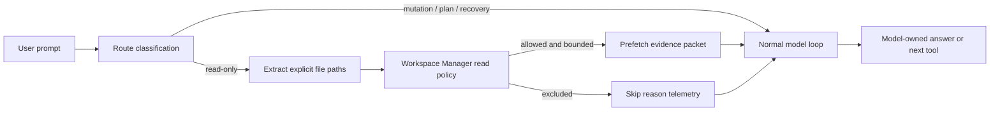

# Read-Only Named-Path Evidence Prefetch Proposal

Status: reviewer-approved design, pending implementation

## Problem

The larger Reasonix-vs-Idiom benchmark exposed a serial evidence transport
problem in Idiom's read-only answer lane. The slow successful run was not a
completion-gate loop, route misclassification, permission failure, or model
refusal.

Verified run evidence:

- Idiom log: `.idiom/benchmark/.idiom/benchmark/conversations/20260611-154038.422.jsonl`
- Idiom benchmark summary: `.idiom/benchmark/20260611-154037-large-fixcheck/summary.json`
- Idiom took 44.47s, 15 model calls, 14 tool calls, 340,538 prompt tokens, and
  2,103 completion tokens.
- Reasonix took 19.43s, 53,053 prompt tokens, and 1,244 completion tokens.
  That fixcheck trial was marked `answer_succeeded:false`, so the raw latency
  comparison is not a clean correctness-equivalent win. Earlier Reasonix large
  trials did succeed, but this proposal treats the comparison as evidence of a
  transport shape, not proof of answer-quality parity.
- Idiom's final-answer call alone used a 31,586-token prompt and had accumulated
  about 71k characters of tool output.
- Idiom's tool sequence was mostly serial file evidence gathering: 9
  `read_file`, 4 `code_navigate`, and 1 `search_content`.
- The run also logged a missing baseline prompt at
  `.idiom/benchmark/prompts/base.md`. That is a confounding setup issue and
  should be fixed independently before treating benchmark deltas as stable.

## Root Cause

The first broken invariant for the slow run is:

> When a read-only prompt explicitly names local source or design files, the
> harness should be able to inject known, permission-safe source evidence before
> the first model turn without deciding the model's answer or strategy.

Reasonix effectively batched the named evidence into fewer model turns. Idiom
made the model spend one hosted model round trip per read/outline/search step,
then replayed accumulated evidence into every subsequent model call. That made a
reasonable evidence-heavy strategy expensive.

The model should still own whether the evidence is sufficient and how to answer.
The harness should own efficient, bounded, auditable transport of already named,
permission-checked evidence. This is a transport architecture gap, not a
general answer-readiness or model-quality failure.

## Proposed Solution

Add a narrow read-only evidence prefetch stage for explicit user-named paths.

The stage runs before the first model call only when all of these are true:

- The route is read-only direct-answer or conversation-style source explanation.
- The user prompt explicitly names one or more existing workspace-relative file
  paths.
- Each path passes the same path resolution, protected-path, symlink, size, and
  read permission policy as normal workspace reads.
- The path is source, documentation, configuration, or prompt material that is
  reasonable to inspect for the answer.

The stage produces a normal evidence packet, not a hidden answer:

- It records the inspected paths in the same evidence path accounting used by
  final-answer acceptance, with `source:"prefetch"` so audit can distinguish
  host-prefetched evidence from model-initiated tool reads.
- It exposes bounded verbatim file excerpts as model context. The harness must
  not summarize, rank, or interpret the file contents.
- It logs a structured event with selected paths, excluded paths, bytes, line
  counts, truncation, policy reasons, dedup counts, and estimated eliminated
  round trips.
- It never writes files, synthesizes the final answer, marks the objective
  complete, or blocks the model from requesting additional tools.

The model remains free to ask for more evidence. The optimization only removes
the needless first N model/tool round trips when the user has already provided
the exact candidate evidence set.

## Locality Boundary

Implementation should stay inside read-only evidence preparation and existing
workspace read policy.

In scope:

- A small path extractor for explicit file mentions in the user objective.
- A path extractor built on existing `pathparse.MentionedWorkspacePaths` /
  token-normalization behavior rather than a second parser.
- A policy adapter extracted from `workspace.Manager` read-path checks, for
  example `resolveSafeReadPath`, so prefetch and `read_file` share one path
  safety authority.
- A bounded prefetch packet inserted into the runner's initial context for
  read-only direct-answer routes.
- Synthetic `workspace.ToolResult` entries for prefetched content so existing
  answerability and final-answer acceptance consume the evidence through the
  normal result pipeline. Prefetched paths count exactly like normal accepted
  source-body evidence for answer acceptance while retaining a distinct audit
  source.
- Activation of the existing direct-answer surface gate by advertising
  `DirectAnswerSurfaceCapSourceBodyPrefetch` and bumping the surface version in
  the same implementation change.
- Telemetry/audit metadata for prefetch hits, skips, caps, and exclusions.
- Focused tests covering inclusion, exclusion, and final-answer acceptance.

Out of scope:

- No changes to write lanes, plan-execute, review-repair, atom intake, or
  recovery.
- No changes to selected-log investigation semantics except the already
  localized diagnostic-trigger fix.
- No forced "answer now" gate after prefetch.
- No prompt reminder that tells the model which strategy to use.
- No global caching or cost-metric redesign.
- No weakening of protected path, symlink, generated-output, or large-file
  restrictions.

## Design Sketch

Candidate ownership:

- `internal/runtime/agent`: decides whether the current route may receive a
  prefetch packet and appends packet context before the first model call.
- `internal/capabilities/workspace`: remains the owner of path resolution,
  protected-path checks, symlink handling, byte caps, and read semantics. Any
  prefetch policy check should be factored from `read_file` behavior, not
  reimplemented outside the manager.
- `internal/runtime/agent/read_only_answerability.go` and
  `internal/runtime/agent/final_answer_acceptance.go`: consume prefetched
  synthetic tool results through the same ledger path as normal source reads.

## Safety Rules

The extractor must be conservative. A path is eligible only when it is an exact
workspace-relative or absolute-under-workspace file reference that exists on
disk. Plain words, package names, symbol names, log ids, session ids, and glob
patterns are not eligible.

The extractor may perform only deterministic syntactic cleanup before checking
existence:

- strip surrounding backticks or quotes from the path token;
- strip a trailing `:N`, `:N-M`, `#L<N>`, or `#L<N>-L<M>` line suffix;
- leave glob characters and unresolved variables ineligible rather than
  expanding them.

The prefetcher must exclude:

- `.git`, secrets, env files, configured protected paths, and outside-root paths.
- Symlink escapes and symlinked files where current read policy would reject.
- Conversation logs, telemetry logs, benchmark generated logs, and large
  generated artifacts by default.
- Binary files and files above the configured byte/line cap.

Caps should be explicit and small enough to prevent prompt ballooning:

- Maximum files: 6 by default.
- Maximum bytes per file: reuse or mirror the normal bounded read cap.
- Maximum aggregate bytes: one dedicated cap for this prefetch packet.
- Truncated files must be marked as truncated and should not be presented as
  complete source-body evidence beyond the included ranges.

Deduplication must be explicit:

- If the same path is mentioned more than once, prefetch it once and record a
  duplicate count.
- If the model later reads a prefetched path through `read_file` or
  `code_navigate`, final-answer acceptance should see one evidence path while
  audit preserves both sources.
- Prefetch context is read-only evidence only. If a future conversation turn or
  sub-phase becomes mutation-capable, the prefetched packet grants no write
  authority and must not expand required or allowed edit scope.

## Test Plan

Unit tests:

- A read-only prompt naming `docs/design-hosted-cache-cost-metrics.md`,
  `internal/runtime/agent/runner.go`, and another source file produces one
  prefetch evidence packet before the first model call.
- The same prompt does not enter selected-log investigation mode merely because
  it contains the words "debug logs".
- Prefetched paths are accepted by final-answer evidence accounting through the
  same path used by normal `read_file` results.
- Prefetch plus a later model-initiated read of the same path dedups evidence
  paths for acceptance and preserves distinct audit sources.
- Mutation, plan-execute, review-repair, and recovery routes never receive this
  packet.
- Outside-root, protected, log, generated, binary, missing, and too-large files
  are skipped with structured reasons.
- The model can still request a normal follow-up read/search after prefetch.
- A prompt whose correct answer requires evidence outside the prefetched set
  still allows the model to gather that additional evidence before answering.
- Backtick-quoted paths and line-suffixed paths are extracted; globs and symbols
  are not.
- Policy parity: every path rejected by normal `read_file` policy is rejected by
  prefetch for the same reason, and every allowed prefetched path would be
  readable through `read_file`.
- Surface gate: `DirectAnswerSurfacePrefetchEligibility` remains false until
  the capability is advertised, then becomes true with the version bump.

Integration checks:

- Re-run the larger benchmark and compare:
  - model call count,
  - tool call count,
  - prompt tokens,
  - cache hit/miss tokens,
  - wall time,
  - answer correctness.
- Confirm no `answer_objective_unmet` or `Selected-log scope enforced` events.
- Confirm `harness_audit` reports the prefetch event without raw file bodies.
- Confirm benchmark summaries include prefetch hit count, skipped count,
  prefetched bytes, and estimated eliminated round trips.

## Rollout

1. Land the already scoped fixes separately:
   diagnostic-log trigger narrowing and canonical prompt install/fallback.
2. Add the named-path prefetch behind an internal default-on route predicate for
   read-only direct-answer only.
3. Keep a config kill switch, for example `IDIOM_DISABLE_READONLY_PREFETCH=1`,
   until benchmark and live-run evidence are stable.
4. Add benchmark summary fields for prefetch hits, skipped paths, prefetched
   bytes, dedup count, and estimated eliminated round trips so future
   comparisons can separate model behavior from transport cost.

## Drift Checks

This proposal intentionally avoids the drift-prone alternatives:

- It does not teach the model a scenario-specific benchmark strategy.
- It does not make the harness decide evidence sufficiency.
- It does not hide or replace normal tool calls.
- It does not relax safety policy.
- It does not change all read-only tasks, only prompts with explicit existing
  file paths.
- It does not mix latency optimization with the diagnostic-log misclassification
  fix or prompt-install fallback.

Reviewer alignment must confirm:

- The canonical owner is evidence transport, not answer readiness.
- The change is route-local and cannot affect mutation lanes.
- Prefetched evidence has the same authority class as bounded `read_file`
  source-body evidence, with truncation clearly represented.
- Telemetry/audit metadata is sufficient to RCA future benchmark deltas without
  reading raw transcripts.
