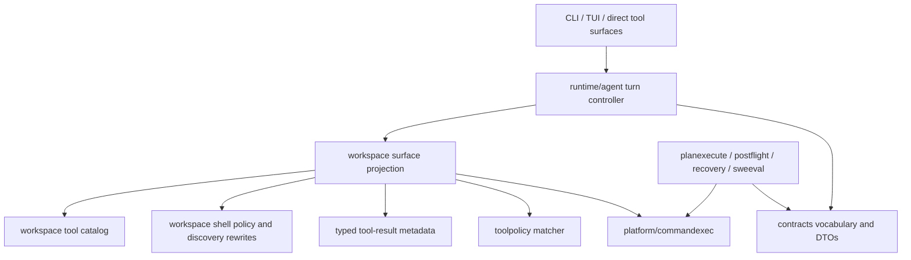

# Rearchitecture Reduction Plan

This plan defines the consolidation target for reducing code count while
preserving Idiom's north-star behavior: the model owns strategy; the harness
owns contracts, evidence, permissions, audit, and verification.

## Safety Definition

Behavior preservation means preserving enforceable harness contracts, not every
current prompt phrase, retry sequence, or model-repair choreography.

Preserve:

- permission checks and protected-path enforcement
- protocol and schema shape
- evidence freshness and source-body support
- verification after writes
- audit event integrity
- final-answer acceptance requirements
- loop bounds and exhausted deliverable budgets
- absence of hidden tools from exposed surfaces
- secret and raw-source handling contracts

Do not preserve as contract:

- exact advisory prompt text
- exact retry counts unless they enforce a real loop bound
- synthesized model-repair steps owned by the harness
- scenario-specific request ordering when the invariant is already covered
- tests that assert wording instead of typed outcomes

## Target Architecture

### 1. Runtime Contract Decisions

Move runtime enforcement toward a typed decision pipeline. Inputs should be
facts about the turn, task family, permissions, evidence, tool result, and
budget state. Outputs should be typed decisions such as allow, reject, nudge,
hide, require evidence, or block, with reason codes and obligations.

The runtime agent should orchestrate the loop. It should not own tool taxonomy,
evidence read models, prompt-specific repair strategy, or workflow-specific
state transitions.

### 2. Tool Surface Authority

Create one neutral owner for tool names, classes, families, visibility,
task-family profiles, and contract metadata. Workspace code should execute
tools. Runtime code should select or project tool profiles. Workerruntime
should depend on the neutral vocabulary, not concrete workspace adapters.

Current-state note: task-family runtime contracts no longer carry duplicated
forbidden-tool inventories for tool-free/read-only profiles. Workerruntime
derives allowed tools from workspace profiles and keeps role-specific
operational prohibitions only where they encode separate constraints.
Read-only role specs and verification-shell control rails now also derive
forbidden workspace-write tools from the workspace write-tool catalog, leaving
only role-specific prohibitions such as delegation or mutating shell markers in
runtime code.

### 3. Implementation Dispatch Workflow

Move plan-document implementation dispatch out of the TUI surface and into
`internal/workflows/implementationdispatch`. The TUI should provide UI,
approval, logging, and prompt-runner callbacks. The workflow package should own
resolution, preflight, refinement, atomization, dirty allowance, continuation,
source-satisfied checks, and closeout.

Current-state note: plan-document resolution, dispatch brief projection,
reference compaction, atom parsing/materialization, terminal atom detection,
source-satisfied evaluation, verification-obligation evidence checks, and atom
closeout mutation now live in `internal/workflows/implementationdispatch`.
Source-satisfied and terminal-atom closeout message construction also lives
with those workflow records. Preflight/refine result types, diagnostics, and
blocked-dispatch message construction are workflow-owned as well. Preflight
command-output interpretation for atom intake and brief lint reports is also
workflow-owned. Nonzero refine accepted-brief sanitization and refined
plan-document replacement are workflow-owned. Plan-document preflight
aggregation, skip rules, and path backfill are workflow-owned; the TUI still
owns orchestration, transient UI logging, and prompt-runner callbacks. The TUI
constructs the refine command request/result, but process execution now goes
through `internal/platform/commandexec` for cwd, timeout, output capture, exit
status, launch failure, and cancellation semantics. CLI refine's default
artifact dispatcher also routes its one-shot child process through
`commandexec`. `queue run` owns admission, lease lifetime, nested held-pool
behavior, and queue env propagation; foreground child process launch, live
stdio, cancellation, and exit classification are owned by
`commandexec.RunForeground`.

### 4. Workspace Manager Decomposition

Decompose `workspace.Manager` into explicit collaborators:

- path observation and handles
- permission and protected-path policy
- internal and external tool registries
- tool manifest projection
- language tooling
- edit recovery
- executor/session facade

The manager should become a composition root or thin session facade, not the
owner of every workspace-related policy.

Current-state note: tool-surface projection, MCP/external registry access, and
known-tool suggestions now live behind a composed workspace `ToolSurface`.
Runtime, CLI, TUI, and workspace tests consume the read-side surface through
`Manager.ToolSurfaceSnapshot()` and explicit profile projections through
`Manager.ToolSurfaceSnapshotForProfile(...)`; plan-execute no longer mutates
workspace manager state to swap tool manifests. Registry installation remains an
explicit manager composition concern. The old live
`Manager.ToolSurface()` session accessor and `ToolSurfaceSession` wrapper were
removed after their callers were migrated. Runtime hidden-tool and
recovery-surface helpers now consume allowed-tool snapshots rather than
accepting `*workspace.Manager` just to inspect the tool surface, leaving Manager
coupling at the runner composition boundary.
Session-local path observation, file-handle assignment, discovered-path checks,
handle resolution, and path-key normalization now live in `PathTracker`.
Workspace path resolution, write-path symlink/root enforcement, read-path
system search approval checks, display-path projection, workspace containment
checks, and system-search approval state now live in `PathAccess`. Write
preflight and projected edit application now live in `WriteGuard` and the edit
projector. Tool-call text transport parsing, JSON repair, XML adapter parsing,
and model-facing tool-result formatting have moved out of `Manager` into
focused workspace files. Read tools, path suggestions, dispatch/timeout
wrapping, unsupported-tool suggestions, external/MCP dispatch, git tools,
shell/command execution, and write adapters now live in separate workspace
files. `Manager` remains the session facade for configuration, mode, path
helpers, and collaborator composition.
Explore-mode mutation blocking now derives from the workspace write-tool
catalog instead of a separate dispatch-owned write-tool map, so adding a new
workspace write tool automatically preserves the read-only dispatch invariant.
Manager pass-through wrappers for workspace containment, relative workspace path
projection, and protected-path key derivation were removed; callers now use the
composed `PathAccess` collaborator directly where the manager is already the
composition root.
Plan-execute model-protocol tool projection now delegates planner-known and
planner-allowed filtering to workspace-owned tool-surface metadata. Symbolic
`RequiredTools` labels and their concrete tool projections now live in
workspace, so workerruntime no longer owns tool taxonomy while the agent still
preserves symbolic history, edit, verification, and bounded-evidence
requirements when compiling model protocol.
Shell command meaning now lives in workspace shell analysis for explore-mode
acceptance, read-only side-effect facts, verification/action class projection,
and write-capable `git diff --output` rejection. Runtime child task policies
share one projection from workspace shell policy into generic toolpolicy rules.
The stale standalone `idiom-analyze` log-shape miner was deleted after shell
replacement redirects were removed; its main purpose was proposing
shell-to-structured-tool redirect rules that no longer align with the harness
north star.
Read-only source-grounding rejection now lives under final-answer acceptance
instead of a separate completion-gate checker. Completion gate projects the
typed acceptance violation into retry/recovery/audit shape, while evidence
projection and delegated child-packet authorities remain the source of what was
actually inspected.
Language-backed read-only capability registry, runtime routing, evidence
capabilities, and discovery profiling now project from a workspace catalog and
the semantic `languagetools` code-navigation spec instead of separate
read-only/code-navigation switches.
Hidden deferred `read_only_capability` facades for `source-sanity`,
`trace-runtime-failure`, and `verify-edit` have been removed; those tools keep
their direct tool schemas/classification, while unsupported requests through
the read-only resolver now use the normal unmapped fallback path. The read-only
capability and tool-schema exports moved to `v2` for the removed fields/error
class, and private non-runtime-routed resolver states now report `unsupported`
instead of preserving a deferred route vocabulary.
Runtime discovery-result meaning now has a single local outcome projection over
`toolfacts.DiscoveryStrength`, candidate paths, search hit count, and broad
search status. Pending-discovery state and read-only answerability consume that
projection; the dead pending-search-hit rejection scaffold was removed, leaving
generic exact-repeat/no-progress controls as the owner of repeated search
behavior. Shell replacement redirects that prescribed `read_file`,
`file_stats`, language-tool, or `source_sanity` follow-up requests from shell
syntax were deleted; workspace shell analysis remains the command-meaning
authority, and runtime no longer converts read-like shell intent into a
harness-chosen strategy. Reviewer-backed follow-up targets are broader
`toolResultEvidenceProjection` consolidation and owner-specific command
authority cleanup. The generic workflow command wrapper target was resolved by
deleting `internal/workflows/commandcheck`; future command work should delete
duplicate execution/display policy in place, not recreate a shared check
facade. Changed-source path classification now belongs to
`toolResultEvidenceProjection` through the `sourcekind.CoversSourceSanity`
contract, and the old read-path pass-through helper has been deleted; the
larger remaining evidence target is a cached projection/read-only answerability
model rather than more caller-local path scanners. Source-body evidence
classification now also belongs to `toolResultEvidenceProjection`: the old
whole-result concrete-source classifier, read-file-specific body helper, and
context-zoom JSON body detector were deleted. Source body is accepted only when
the projection can derive path-backed source-body evidence from typed producer
facts, while read-only answerability remains the objective-scoped policy owner.
	The next evidence pass should replace repeated raw-result branching in
	`readOnlyAnswerabilityForResults` with a cached normalized projection model,
	not add more single-call helper wrappers. The first observation-model pass now
	has `readOnlyAnswerabilityForResults` consuming projection-owned evidence
	observations for generated artifacts, diagnostics, source/external bodies, plan
	artifacts, outlines, context packets, search hits, and semantic discovery
	candidates. The next projection pass made each `ToolResult` a normalized
	evidence record, deleting the old tool-surface read-path helper, candidate-only
	result helper, routed-source body detector, plan-execute source-evidence
	classifier, and zero-value per-result projection calls. The remaining
	projection target is wider reuse: many runtime callers still construct fresh
	projections over the same result slice instead of carrying one turn-level read
	model.

### 5. Product Workflow Projection

Move product audit/status view construction into workflow packages. CLI code
should parse arguments, call workflow use cases, and render returned view
models.

## Test Strategy

Replace large scenario tests that freeze strategy with smaller contract tests.

Keep tests that prove hard invariants:

- no write without permission
- no protected-path mutation
- no hidden tool exposure
- no accepted final answer when required evidence is missing
- no raw source or secret leakage in audit/user-facing output
- no source-satisfied state without path-backed evidence
- stable public JSON and audit schemas

Retire or rewrite tests that pin:

- advisory wording
- exact "Try:" examples
- synthesized write-description repairs
- exact request counts for recovery paths
- prompt-specific blocker phrasing
- model strategy chosen by the harness when multiple valid strategies remain

## Rollout Sequence

1. Add characterization around typed contract decisions and audit events.
2. Introduce neutral tool-surface vocabulary and migrate duplicated readers.
3. Extract runtime evidence/tool-surface decisions behind typed interfaces.
4. Move implementation dispatch workflow behavior out of the TUI surface.
5. Decompose workspace manager responsibilities.
6. Consolidate product workflow audit/status projection.
7. Delete strategy-freezing tests and obsolete recovery code after semantic
   contract coverage is in place.

Each slice should be verified with focused package tests first, then
`go test ./...` and `go build ./cmd/idiom` when shared runtime behavior changes.

## Runtime Agent Contract-Decision Slices

These slices come from the focused runtime-agent reviewer pass. They are the
first runtime implementation track because they remove harness-owned strategy
without weakening harness-owned invariants.

### Slice 1: Write-Description Repair Strategy

Keep the invariant that diff-producing writes require a non-empty
`description`, and keep permission/source-evidence/required-path gates. Delete
the harness behavior that synthesizes a missing description, hides unrelated
tools, rejects non-write detours during repair, or expects a specific retry
sequence. The model owns how to recover after a typed missing-description
rejection.

Tests should keep missing-description rejection, valid described writes,
permission-denial priority, and no mutation on rejection. Tests should delete
or replace assertions for `Try:` wording, synthesized descriptions,
`write_description_repair_synthesized`, exact request counts, and repeated
non-write-detour blockers.

### Slice 2: Evidence Decision Read Model

Collapse the temporary `EvidenceEngine` seam unless it becomes a real owned read
model. Evidence readiness, pending source-body redirects, and citation support
should be tested through concrete result fixtures and typed outcomes, not by
asserting that runner helpers consult an injectable wrapper.

Current-state note: the `EvidenceEngine` seam has been removed from the runtime
agent. The adjacent `GuidanceEngine` injection seam was also removed because it
only wrapped deterministic closure/readiness predicates and encouraged tests to
override readiness instead of proving concrete evidence outcomes.

### Slice 3: Tool-Surface Authority

Make typed phase projections and `ActiveSurface` the runtime authority for
visible, hidden, and callable tools. Replace runner-local hide/release maps and
textual allowed-tool helpers with owned tool-surface projections. Tests should
assert hidden-tool and callable-action invariants rather than exact recovery
prompt prose.

Current-state note: scoped implementation hidden-tool ownership now lives in
`ActiveSurface` under `OwnerImplementationScoped`; the separate
`implementationScopedHiddenTools` runner map and
`hideImplementationScopedToolsForTurn` helper were removed. The stale autonomy
test that required non-planner `code_navigate` to keep an empty legacy fallback
was retargeted to the shared tool-surface metadata invariant.

Current-state note: generic per-turn runtime hides now also flow through
`ActiveSurface` with explicit owners for source grounding, child packets, loop
policy, discovery redirects, `list_files` gating, and task delegation. The
runner-local `turnHiddenTools` bool map, its phase-contract bridge, and the
map-mutating hide helpers were removed, leaving `ActiveSurface.FilterVisible`
as the single runtime visibility filter during tool rebuilds. The obsolete
`syncToolSurfaceFromBridge` wrapper and its wrapper-focused test were also
removed; callers refresh active-surface visibility through the surface API
itself.

## Current Implementation Queue

### Slice 1: Tool-surface taxonomy consolidation

- Use workspace-owned runtime classification helpers from agent code.
- Remove agent-local duplicated language-tool lists.
- Keep tool-progress accounting tied to semantic write/read contracts, not
  hard-coded language prefixes.

Primary files:

- `internal/capabilities/workspace/tool_class.go`
- `internal/runtime/agent/tools_surface.go`
- `internal/runtime/agent/runner_core.go`

Focused tests:

- `go test ./internal/capabilities/workspace ./internal/runtime/agent`

Current-state note: implementation target-source and target-write-ready
allowed-tool projections now live in `workspace/tool_surface_phase.go`.
Runtime-agent code still decides when those phases are active and appends
evidence-dependent redirect tools, but the static tool taxonomy for those
phases is no longer encoded as raw string lists in `contracts_recovery.go`.

Current-state note: implementation verification-ready, verification-repair,
plan-execute required-source, candidate-source, anchor-refresh, submit-only,
and review-repair terminal-probe tool projections now also live in
`workspace/tool_surface_phase.go`. Runtime-agent code still owns phase
selection, evidence interpretation, transport details, and prompt rendering,
but these static callable-tool surfaces are no longer runtime-local raw lists.

Current-state note: plan-execute history-pending concrete tools live in
`workspace/tool_surface_phase.go`, and the symbolic
`history_range_or_history_symbol` required-tool label now lives in workspace's
required-tool vocabulary. `blame_range` remains runtime history inspection but is
explicitly excluded from the history-pending submit-plan rationale surface.
Task-ledger read-evidence tool classification now lives in
`workspace/tool_class.go`, with runtime using the workspace predicate instead of
local Go/Python-only read-tool lists.

Current-state note: workspace now has private named projection inventories for
read-only discovery, delegated read-only discovery, guarded write,
implementation pre-write/target-source/write-ready/verification/repair,
plan-submission review, and plan-execute recovery surfaces. Static phase
inventory callers now use the typed `ToolSurfacePhase` API
(`ToolSurfacePhaseToolNames`, `ToolSurfacePhaseAllowedTools`, and
`ToolSurfacePhaseAllowsTool`) instead of one exported helper per phase. Profile
helpers remain for runtime/workerruntime contracts, but static inventories
project from one ordered table instead of separate hand-built slices. Phase tests
now assert required/forbidden contract invariants rather than duplicating every
tool-list element.

Current-state note: direct-answer tool inventory is also workspace-owned through
the named projection table. Runtime still owns direct-answer lane detection,
surface telemetry schema/version, capabilities, and terminal states, but it no
longer keeps an agent-local read-only tool list or exclusion map.
Current-state note: plan-execute terminal submit-only runtime surfaces and
planner required-tool rails now use the workspace
`ToolSurfacePhasePlanExecuteSubmitPlanOnly` projection instead of raw
runtime-local `submit_plan` slices.

Current-state note: plan-execute phase policy projection now lives in workspace
as `PlanExecuteToolSurfaceProjection`. Runtime-agent code still owns deriving
the active planning mode, evidence state, transport mode, phase ids, and prompt
rendering, but the static callable tools, parser-visible tools, action-class
policy, submit-terminal widening, submit-correction terminal policy, and
terminal response shapes are no longer duplicated in
`PlanExecutePlanningState.applyProjection`.

Current-state note: workspace tool-surface profile and phase selection are now
table-backed. `ToolSurfaceProfile` values project through shared projection
specs for direct-answer, read-only discovery, guarded write, plan-submission,
implementation-scoped edit, verification-only, locate-only, and delegated
surfaces; `ToolSurfacePhase` values map through a projection table instead of a
phase switch. Runtime no longer carries the removed
`workspaceExternalToolIsReadOnlyDiscovery` pass-through call sites; scoped
implementation checks consume the copy-safe tool-surface snapshot's
`ExternalToolIsReadOnlyDiscovery` predicate directly.

Current-state note: built-in runtime tool-class membership for read-class,
runtime content inspection, runtime search/orientation guidance, source-body
inspection, task-ledger read evidence, instruction attachment, broad discovery,
and repeated-tool narrow families now lives in private workspace catalog facet
metadata. Public workspace predicates still provide the stable API to runtime,
but their built-in tool lists are no longer repeated as switch statements in
`tool_class.go`; language-tool classification continues to derive from the
language registry capability metadata.

Current-state note: `ToolSurfacePhase` is now a direct alias of the workspace
projection ID, and public phase constants reuse the projection constants rather
than passing through a second phase-to-projection map. Runner advertised-tool
filtering also moved to `ToolSurfaceSnapshot.AdvertisedAllowedTools`, so
conversation-only external-tool exposure, runtime-brief order preservation,
task-tool suppression, and artifact-final tool suppression are workspace
surface behavior instead of agent-local set logic.

Current-state note: workspace no longer re-exports semantic language registry
lookup helpers (`LanguageRegistry`, `LanguageForFile`, `LanguageForName`,
`LanguageForExtension`, `DiagnosticToolNames`, `IsDiagnosticToolName`). Runtime,
workspace tests, harness audit, and project artifact enrichment now call
`internal/repository/semantic/language` directly for registry facts. Workspace
also no longer re-exports language capability/type aliases; callers use the
semantic language owner directly. Workspace keeps only `Manager.ActiveLanguages`
as the root-bound active-language projection, where workspace session state is
part of the behavior.

### Slice 2: Tool profile ownership

- Move runtime profile allow-list projection out of `workerruntime` and into a
  neutral tool-surface owner.
- Keep workspace responsible for schemas, examples, execution, and adapter
  rendering.
- Keep workerruntime responsible for task-family contracts, not concrete
  workspace tool taxonomy.

Primary files:

- `internal/capabilities/workspace/tool_surface_metadata.go`
- `internal/capabilities/workspace/tool_manifest.go`
- `internal/runtime/workerruntime/catalog.go`

Focused tests:

- `go test ./internal/capabilities/workspace ./internal/runtime/workerruntime`

Current-state note: `workerruntime` no longer defines or re-exports
`ToolCapabilityProfile` / `Capability*` profile constants. Runtime contracts
now store `workspace.ToolSurfaceProfile` directly, and tests assert
workspace-owned profile metadata. Delegated read-only tool selection is now a
workspace-owned surface profile (`ToolSurfaceProfileDelegatedReadOnly`) instead
of a `workerruntime` local filter. The harness scratch `note` tool name is
owned by the shared autonomy/workspace tool-name contract instead of raw string
checks in profile code.

Current-state note: `internal/capabilities/toolcatalog` has been removed.
Its generic clone-safe wrapper only served workspace metadata, so the built-in
tool catalog is now a private workspace type in `tool_surface_metadata.go`.
Workspace metadata tests continue to assert defensive copies and real surface
projections instead of testing an exported package boundary that no longer
exists.

Current-state note: implementation phase filters for pre-write and scoped-edit
surfaces now live in `internal/capabilities/workspace/tool_surface_phase.go`.
Agent code decides when those phases are active, but workspace owns which tools
the phase permits, including submit-plan, semantic discovery, and read-only
external discovery tool handling. The duplicate agent helper block and the
agent-side scoped-edit allowlist test were removed. The remaining scoped-edit
external-discovery extension now accepts a read-only-discovery predicate, so
runtime callers can use the copy-safe tool-surface snapshot without depending
on the external-tool registry object. The package-local `agentutil` middleman
struct was also removed; runtime code and tests now call the owning helper
functions directly instead of routing through a non-overridable pass-through
table.

Current-state note: workerruntime next-action guidance no longer owns a raw
list of Go search/navigation tool names. Search-result and orientation-guidance
tool families are now workspace taxonomy helpers backed by built-in tool
classes and language evidence capabilities, so new non-Go language tools inherit
the same guidance without runtime string-list edits.

Current-state note: plan-execute textual surface projection now uses
workspace-owned helpers for generic tool filtering, review-repair initial
probe tools, submit-plan-only projection, projection precedence, and
parser-visible request widening. The runtime agent still owns deriving
`PlanExecutePlanningState` and contract/audit emission; textual allowed-tool
filtering no longer derives a shadow `TurnPhaseContract` just to recover the
same callable-tool projection.

Current-state note: plan-execute phase-contract projection now consumes
`PlanExecutePlanningState` directly for phase id, phase name, derivation reason,
terminal shapes, callable tools, and action-class policy. The fallback phase
constants in the adapter helper and the private-helper projection test were
removed so the planning state is the only plan-execute phase-policy source.

Current-state note: plan-execute runtime-call policy no longer duplicates the
generic `RuntimeCallPolicy` shape. Plan-execute derivation now returns the
generic policy with submit-ready defaults applied, and the small plan-execute
transport/telemetry projections are methods on that shared policy.
Runtime-call telemetry and tests now use `ToolTransportMode` directly; the
plan-execute-only `PhaseTransportMode` alias and response-format telemetry
wrapper were removed. Runner phase-contract input now derives the runtime-call
policy once and projects transport, textual parser state, thinking policy, and
runtime limits from that typed policy instead of rebuilding those fields through
separate runner helpers.
Native submit-plan correction now renders the shared typed
`PlanExecuteRecoveryPlan` instead of maintaining a second prompt string builder;
prompt-wording tests for the removed bespoke helper were replaced by the typed
native-only tool/terminal contract test.
Plan-execute readiness tests no longer pin advisory nudge phrasing for
submit-ready and candidate-scope states; they assert typed planning state,
selected edit paths, and submit-plan availability.

Current-state note: plan-submission profiles now own required-tool completion
for `submit_plan` inside workspace profile projection. `workerruntime` selects a
`ToolSurfaceProfile` and receives the projected tools; it no longer patches
`submit_plan` back into planner/review briefs after filtering.
Runtime briefs now name the workspace manifest entry type directly, and runtime
brief normalization calls workspace manifest build/sanitize functions directly.
The duplicate runtime manifest struct, workspace-to-runtime conversion helper,
placeholder-request sanitizer, and runner-local `runnerSanitizedToolManifest`
wrapper were removed.
Symbolic runtime `RequiredTools` labels now live in workspace with a single
`ConcreteRequiredTools` projection to workspace tool names. Runtime catalog
specs, visible-brief shaping, control rails, TUI prompt-routing filters, and
textual tool-protocol manifest selection no longer duplicate labels such as
`edit_file_or_apply_patch` or `bounded_workspace_evidence_tool` outside the
owning workspace vocabulary.
The `bounded_workspace_evidence_tool` concrete projection now delegates to the
workspace candidate-source phase surface instead of carrying a second read/search
tool list in runtime code.
The exact per-edit write adapter set (`edit_file`, `write_file`, `append_file`,
`apply_patch`) now has a workspace-owned helper and predicate; runtime required
tool projection, headless path policy, and TUI/runtime write-label guards reuse
that helper instead of restating the four-tool set.
Submit-correction wrong-tool recovery now renders the shared typed
`PlanExecuteRecoveryPlan`, including the typed exact-blocker terminal option
after repeated unsafe submit-plan failures, instead of maintaining a separate
prompt body.
The duplicate hidden-only submit-correction prompt wrapper and unused runner
receiver method were removed; hidden-only recovery now uses the single
state-aware visible-prompt helper.
Plan-execute recovery-plan tests now assert typed plan fields (`Kind`,
`AllowedTools`, `TerminalOptions`) instead of rendering recovery prompts to
pin advisory prose.

Current-state note: recovery cards no longer synthesize read-only final-answer
or evidence-pending strategy prose, and they no longer render
`deterministic safe next action: none available` when no deterministic
harness-owned action exists. The card still exposes callable tools, callable
action classes, visible safe alternatives, recovery state, and exact blocker
shape as typed contract facts.

Current-state note: the dormant host-owned read-only closeout surface has been
removed. `ReadOnlyCloseout` still owns read-only answerability, blocker
presentation, and model-authored terminal recovery candidates, but the
always-disabled host-authored answer hooks, terminal acceptance branch, stale
stop-reason fixtures, and tests that only proved the dead hooks stayed false
are gone.

Current-state note: the runtime-agent source-text de-drift meta-tests have
been removed. `contract_surface_tests_test.go` still checks the real guidance
documents and contract behavior, but it no longer walks production source with
regex detectors for helper names, prompt phrases, local objective classifiers,
or action-class string literals. Future duplicate-authority regressions should
be covered by typed contract tests on the owning surface rather than a private
test-only linter.

Current-state note: `next_action_state` now builds the typed recovery card once,
renders that card for the model-facing JSON field, and reuses the same card for
the autonomy `recovery_card` surface summary. The autonomy path no longer
reconstructs a second card from parallel inputs.

Current-state note: `next_action_state` autonomy summaries no longer parse
`NextValidActions` / `InvalidNextActions` advisory prose to infer action
classes. They project advertised and invalid action classes from
`TurnPhaseContract.ActionPolicy` intersected with runtime-expressible classes.
The prompt-wording classifier helpers and tests were removed.

Current-state note: recovery cards no longer carry or render a
`deterministic safe next action` strategy field. The card surface now stays on
harness-owned facts: invariant, rejected action, evidence refs, callable tools,
callable action classes, visible safe alternatives, recovery state, and exact
blocker shape. The write-ready and pending-redirect strategy-string helpers and
tests were removed.

Current-state note: the runner-local `CardEngine` pass-through interface has
been removed. Recovery-card construction and rendering now use
`BuildRecoveryCard` / `RenderRecoveryCard` directly; the remaining
plan-execute recovery hooks are separate behavior seams rather than a generic
card wrapper.

Current-state note: lane policy is now table-backed by immutable policy specs
instead of four empty concrete structs with duplicated constant-return methods.
The remaining interface and method-wrapper layer has also been collapsed into a
concrete `LanePolicy` spec plus narrow helpers for computed values. Unused
policy-owned recovery-nudge render methods were removed; recovery nudges remain
owned by the existing priority-ordered recovery rules. Lane-policy tests now
assert semantic behavior such as force-completion, recovery-nudge suppression,
note-tool exposure, confidence caps, and milestone schedules instead of
requiring specific concrete policy types.

Current-state note: the unexported `planExecuteRecoveryHooks` injection seam
has been removed. Plan-execute recovery now calls concrete typed recovery-plan
helpers directly, and tests no longer assert injected recovery-engine dispatch.
The remaining tests cover actual recovery states, parser recovery, native
fallback prompts, low-value action recovery, and anchor-refresh rejection
behavior.

Current-state note: `ModelCallReadinessPolicyEngine` has been removed. The
pre-model-call operational limit is now a plain typed decision function, and the
runner no longer carries a test-injectable field for that harness-owned budget
invariant. Tests now cover advisory model-call budgets and the real operational
model-call closeout path instead of an injected readiness stop reason.

Current-state note: the runner-local `GateEngine` facade has been removed.
Completion-gate evaluation now runs the real internal pipeline and then the
explicit external `CompletionGate` callback. Read-only source grounding calls the
owned source-grounding helper directly. Tests no longer assert injected retry
budgets, injected gate replacement, or injected source-grounding rejection.

Current-state note: the remaining runner-local `VerificationPolicyEngine`,
`LifecycleCloseoutPolicyEngine`, and `ToolAuthorizationPolicyEngine` facades
have been removed. Verification, lifecycle closeout, and tool-authorization
decisions are now plain typed package functions. Tests assert the real decision
payloads, event metadata, and lifecycle gate state instead of injected
policy-engine dispatch.

Current-state note: the test-only `runnerLoopPolicy` pass-through wrapper has
been removed. Loop-budget tests now call the underlying request-budget
decisions wrapped with `attachLoopPolicyDecision`, matching production and
keeping policy metadata assertions without a duplicate facade.

Current-state note: current-tool-surface rejection now flows through the typed
`toolAuthorizationSurfaceDecision` function, with user-facing rejection text
owned by `ActiveSurface.RejectionForTool`. The legacy tuple-return
`currentToolSurfaceRejection` helper and repeated manual
`current_tool_surface` policy-event construction were removed; tests now assert
typed surface decisions instead of a separate rejection helper.

Current-state note: contract compilation no longer owns or imports concrete
workspace planner tool vocabulary. Workspace projects the tool-surface catalog
into plain planner metadata, runtime passes that metadata into the passive
compiler, and `internal/contracts/compile` validates and compiles only from its
input model. Compiler tests now use a small local fixture to prove metadata
normalization and rejection behavior without becoming a second workspace
taxonomy authority.

### Slice 3: Workspace manager facade split

- Extract tool-surface projection, MCP/external registry access, and known-tool
  suggestions behind a composed workspace tool-surface collaborator.
- Extract path observation and file-handle state behind a composed path-tracker
  collaborator.
- Keep existing `Manager` methods as compatibility delegators until runtime
  callers are migrated.

Primary files:

- `internal/capabilities/workspace/manager.go`
- `internal/capabilities/workspace/tool_manifest.go`
- `internal/capabilities/workspace/external_tool.go`

Focused tests:

- `go test ./internal/capabilities/workspace`

Current-state note: `workspace.Manager` now composes `ToolSurface` and
`PathTracker`. `ToolSurface` owns manifest projection, profile filtering,
MCP/external registry access, allowed-tool computation, and known-tool
suggestions. `Manager.ToolSurfaceSnapshot()` exposes a copy-safe read model for
allowed tools, tool definitions, available external names, and external-tool
predicates; runtime, CLI, and TUI production callers have been migrated to the
snapshot or explicit manager methods instead of reaching through a live
`ToolSurfaceSession`, which has been deleted. `PathTracker` owns observed-path
evidence, file-handle allocation, discovered-path checks, and handle lookup.
`PathAccess` owns workspace path resolution, read/write path access checks,
display-path projection, workspace containment, and system-search approval
state. `Manager` remains the session facade for compatibility and collaborator
composition. Legacy `Manager.AllowedTools` and
`Manager.BuildToolDefinitions` callers have been migrated, so those
pass-through delegators are gone. Tool-request parsing, tool-result formatting,
read/list/search/file-stats tool behavior, and path-recovery suggestions are no
longer manager-owned.

### Slice 4: Agent textual plan-execute surface projection

- Move remaining plan-execute textual allowed-tool fallback/projection logic out
  of `internal/runtime/agent/tools_surface.go`.
- Keep agent ownership of turn state and transport selection, but move phase
  projection to a typed workspace/workerruntime surface contract.
- Replace tests that assert exact fallback arrays with tests for contract
  states: initial review-repair probe, submit-only terminal state, history
  pending state, and source-refresh exception state.

Primary files:

- `internal/runtime/agent/tools_surface.go`
- `internal/runtime/agent/contract_surface_tests_test.go`
- `internal/capabilities/workspace/tool_surface_phase.go`

Focused tests:

- `go test ./internal/capabilities/workspace ./internal/runtime/agent`

Current-state note: textual plan-execute allowed-tool resolution now lives in
workspace as `PlanExecuteTextualAllowedTools`. Runtime-agent code still derives
the planning state, review-repair terminal contract, source-satisfied terminal
completion, and submit-plan terminal eligibility, but workspace owns the generic
projection fallback order for planner, review-repair, submit-only, and no-tool
terminal states. Workspace tests now cover that policy beside the existing
parser-visible request widening tests.

### Slice 5: Workspace path-access resolver

- Extract read/write/workdir resolution and display-path projection behind a
  focused path-access collaborator.
- Keep system-search approval and protected-path checks explicit; do not merge
  them into `PathTracker`.
- Preserve stale-handle semantics: an explicit valid `read_file.path` wins over
  a stale `read_file.id`, and unknown handles still fail with typed errors.

Primary files:

- `internal/capabilities/workspace/manager.go`
- `internal/capabilities/workspace/system_search_access.go`
- `internal/capabilities/workspace/tool_rules.go`

Focused tests:

- `go test ./internal/capabilities/workspace`

Current-state note: `PathAccess` now owns `ResolvePath`, `ResolveWorkdir`,
`ResolveWritePath`, `ResolveReadPath`, `ResolveReadWorkdir`,
`SystemSearchCandidate`, `DisplayPath`, workspace containment checks, selected
directory checks, and the session-scoped system-search approval grant set.
The system-search candidate, approval-scope, grant-recording, grant-snapshot, and
selected-directory pass-throughs have been removed from `Manager`; the grant
snapshot type now lives with `PathAccess`. Generic read/write/workdir resolver
and display-path callers now use `m.pathAccess` directly, leaving `Manager` to
own path/handle session composition instead of forwarding path-access methods.

### Slice 6: Workspace write/edit guard owner

- Move write-file, edit-file, planned-write validation, edit-recovery state,
  syntax preflight, and artifact-protection checks behind write/edit
  collaborators.
- Keep the read-before-edit invariant by consuming `PathTracker` observed-path
  evidence instead of letting write code own path-observation state.
- Replace brittle tests that pin advisory wording with contract tests for
  permission denial, protected-path denial, unobserved-path rejection, recovery
  clearance after read, and successful verified writes.

Primary files:

- `internal/capabilities/workspace/manager.go`
- `internal/capabilities/workspace/read_prefetch.go`
- `internal/capabilities/workspace/patching`

Focused tests:

- `go test ./internal/capabilities/workspace`

Current-state note: planned-write validation, syntax preflight, adjacent
duplicate-code rejection, JSON validation, syntax-recovery debt tracking, and
recovery clearance after bounded reads/diffs now live in `WriteGuard`.
Read-before-edit rejection also lives in `WriteGuard`, which consumes
`PathTracker` observation evidence through a predicate rather than owning
observed-path storage. Completed planning artifact detection and source-like
planned-write hygiene helpers moved with the guard. `edit_file` content
projection for exact anchors and line ranges now lives in a pure
`edit_projector`; `Manager` still owns path resolution compatibility
delegators while the direct `write_file`/`edit_file`/`mkdir` tool adapters now
live in `write_tools.go`.

### Slice 7: Workspace tool request parser split

- Move tool-call text extraction, JSON repair, provider XML parsing, and
  tool-result model formatting out of `manager.go`.
- Keep the public workspace entrypoints stable: `ParseToolRequest`,
  `DecodeToolRequestJSON`, `FormatToolResultForModel`, and `FormatToolTrace`.
- Do not create a separate parser package until tool names, read/write safety
  predicates, and language-tool aliases can move without cycles.

Primary files:

- `internal/capabilities/workspace/tool_request_parse.go`
- `internal/capabilities/workspace/tool_request_json_repair.go`
- `internal/capabilities/workspace/tool_request_transport.go`
- `internal/capabilities/workspace/tool_request_xml.go`
- `internal/capabilities/workspace/tool_result_format.go`

Focused tests:

- `go test ./internal/capabilities/workspace -run 'TestParseToolRequest|TestDecodeToolRequestJSON|TestLooksLikeXMLToolCallMarkup|TestFormatToolResultForModel'`
- `go test ./internal/capabilities/workspace`

Current-state note: `tool_request_parse.go` is now a thin public entrypoint.
JSON decode repair and alias normalization live in
`tool_request_json_repair.go`; generic textual envelopes and safe bare-JSON
tool-call detection live in `tool_request_transport.go`; Qwen/DeepSeek/XML
transport adapters and XML safety gates live in `tool_request_xml.go`; model
tool-result rendering and context-pack compaction live in
`tool_result_format.go`.

### Slice 8: Workspace read-tool split

- Move `list_files`, `search_files`, `read_file`, file-stats, log-tail
  projection, read-path recovery, and path suggestions out of `manager.go`
  while keeping method receivers on `Manager`.
- Preserve handle assignment and observed-path marking through `handleDisplay`
  and `read_file` success paths.
- Keep access authority in `PathAccess` and existing system-search denial
  helpers; do not introduce a generic walker that hides per-tool policy.

Primary files:

- `internal/capabilities/workspace/read_tools.go`
- `internal/capabilities/workspace/path_suggestions.go`
- `internal/capabilities/workspace/text_limits.go`
- `internal/capabilities/workspace/workspace_helpers.go`

Focused tests:

- `go test ./internal/capabilities/workspace -run 'Test(SystemSearchAccess|ResolveReadPath|ReadFile|ListFiles|SearchFiles|FileStats|FindPathSuggestions|SearchContentZeroHitSuggestsPathsWhenPatternLooksLikeSymbol|PrefetchReadFiles)'`
- `go test ./internal/capabilities/workspace`

Current-state note: read-oriented tool behavior now lives in `read_tools.go`,
path recovery and zero-hit suggestion enrichment live in `path_suggestions.go`,
and shared truncation limits live in `text_limits.go`. The duplicate
workspace candidate walk used by `findPathSuggestions` and `tokenMatchedPaths`
is consolidated behind a raw candidate collector that does not assign handles
until suggestions are rendered. Duplicate fabricated-parent `read_file`
recovery wording is consolidated behind one helper.

### Slice 9: Workspace dispatch and mutation adapter split

- Move dispatch/timeout ownership, unsupported-tool recovery, external/MCP
  backend calls, git tools, shell validation/execution, command running, and
  write adapters out of `manager.go`.
- Keep executable built-in dispatch owned by the workspace tool-surface catalog;
  visible tool-routing policy should live beside the metadata that declares the
  tool contract, with language, MCP, and external-tool fallbacks preserving
  their existing precedence.
- Consolidate explore-mode write rejection and language-index invalidation
  without weakening write or read-only contracts.

Primary files:

- `internal/capabilities/workspace/tool_dispatch.go`
- `internal/capabilities/workspace/tool_name_suggestions.go`
- `internal/capabilities/workspace/external_mcp_dispatch.go`
- `internal/capabilities/workspace/external_tool_definitions.go`
- `internal/capabilities/workspace/git_tools.go`
- `internal/capabilities/workspace/shell_tools.go`
- `internal/capabilities/workspace/command_runner.go`
- `internal/capabilities/workspace/write_tools.go`

Focused tests:

- `go test ./internal/capabilities/workspace -run 'TestToolTimeout|TestExecuteWithTimeoutFn|TestManagerBuildToolDefinitions|TestManagerAllowedTools|TestManagerExecute_|TestManagerDoesNotAdvertiseUnavailableExternalTools|TestManagerBoundsExternalToolOutput|TestGit|TestExploreShellClassificationAndValidation|TestShouldClearBroadInspectionLock|TestStructuredNarrowingUsesSharedRegistryPredicate|TestExecuteReadWriteAndExploreWriteRejection|TestEnvWithCanonicalPWDOverridesLogicalPWD|TestUnsupportedToolErrorSuggestsClosestNames'`
- `go test ./internal/capabilities/workspace`

Current-state note: `manager.go` is now the workspace session facade at roughly
500 lines. Dispatch/timeout wrapping lives in `tool_dispatch.go`, while
executable built-in handler IDs are declared from `tool_surface_metadata.go`
alongside the catalog metadata that defines each tool contract. One handler-ID
executor preserves the language-tool fast path, MCP fallback, external-tool
fallback, timeout behavior, and explore-mode write rejection, while avoiding
per-tool pass-through adapter functions. Unsupported-tool suggestions live in
`tool_name_suggestions.go`; external/MCP dispatch and external definition
projection live beside the tool surface; git, shell policy/execution, command
running, and write adapters live in focused files. Paired Go/C++ index reset
calls were replaced by `invalidateLanguageToolsAfterWorkspaceMutation()`, which
matches the actual shared language-manager reset behavior.

## Single-Authority Surface Architecture

Reviewer synthesis date: 2026-07-07.

The next reduction target is not another file split. It is a single-authority
recut across tool surfaces, shell intent, command execution, typed evidence, and
legacy compatibility surfaces. Broad reductions become safe only after callers
consume one owner for each enforceable fact.

### Ownership Map

- `internal/capabilities/workspace` owns the model-facing workspace tool
  contract: built-in tool existence, handler IDs, capabilities, side effects,
  write/read classification, schema and manifest projections, phase/profile
  surface resolution, request target extraction, shell policy, discovery
  rewrites, and typed workspace tool-result metadata.
- `internal/platform/commandexec` owns process execution details:
  `os/exec`, `Run`, `Start`, shell mode, timeout, exit status, bounded
  stdout/stderr capture, duration, optional canonical `PWD`, and environment
  overlays.
- `internal/contracts/*` owns stable vocabulary and public contracts: autonomy
  action-class vocabulary, plan verification command contracts, submit-plan
  diagnostics, read evidence metadata, recovery records, and audit DTO shape.
- `internal/runtime/agent` owns turn/session orchestration: loop sequencing,
  budgets, evidence gates, recovery/nudge policy, redirect retry behavior, and
  temporary per-turn surface hides. It must not re-enumerate workspace tool
  names, parse shell syntax, execute commands, parse tool-result summaries, or
  duplicate workspace validation.
- `internal/capabilities/workspace/toolpolicy` owns only pattern matching over
  caller-provided policy targets. Workspace owns target extraction.
- CLI, TUI, and workflow packages own request construction, validation, exit
  projection, and presentation for their surfaces. They should adapt to
  workspace/contracts/platform results, not own duplicate shell, tool, or
  process execution rules.

### Authority Objects To Add Or Harden

1. `workspace.ResolveToolSurface(input)` should be the only phase/profile
   surface resolver. Inputs include base tools, profile, phase, external
   metadata, mode, and temporary runtime hides. Outputs include callable tools,
   advertised tools, manifest inputs, and deny reasons. Runtime applies the
   result; it does not rebuild allowed-tool lists.
2. `workspace.ActionClassForTool` and related projections should derive from
   the workspace catalog and contract vocabulary. `contracts/autonomy` keeps
   canonical action-class names and audit DTOs, not concrete workspace tool-name
   maps.
3. `workspace.AnalyzeShellCommand(command)` should return a typed decision:
   parsed head/argv facts, control-syntax facts, action class, side effect,
   explore-allowed status, verification family, policy target, reject reason,
   and optional structured replacement candidate. Runtime redirect code should
   consume this decision instead of owning `cat`/`sed`/`grep`/`rg`/`wc` parsers.
4. `platform/commandexec` should expose `Run(ctx, Spec) Result` and
   `Start(ctx, Spec) Process`. `Spec` should distinguish argv execution,
   plain shell, and login shell. `Result` should include stdout, stderr,
   combined output, exit code, timed-out status, truncation flags, duration, and
   error classification.
5. `workspace.PolicyTarget` and `workspace.WriteTargetPaths` should be the only
   request target extractors for tool rules and write-path checks.
6. Workspace tool results should carry optional typed metadata alongside
   existing text summaries. Required read metadata includes path, requested
   range, returned range, total lines, clamped/default-tail flags, log-like
   classification, freshness, and evidence handles. `submit_plan` should return
   typed diagnostics for coverage, grounding, anchor validity, projection, and
   rejection categories.

### Migration Order

1. Add characterization tests around current tool surface projection,
   shell-policy decisions, command execution semantics, read metadata parsing,
   and submit-plan rejection behavior. These tests should assert typed outcomes,
   not prompt wording.
2. Make the workspace catalog the source for tool action-class, capability,
   side-effect, profile, phase, manifest, schema, write-tool, and target
   projections. Keep presentation records keyed by catalog tool names and add
   completeness tests so drift is mechanical failure.
3. Move shell parsing and shell classification into workspace. Replace runtime
   shell side-effect, workbranch shell allow/deny, and discovery redirect parser
   tables with calls to the workspace classifier. Runtime keeps only redirect
   escalation, retry, fingerprint, and user-facing recovery text.
4. `internal/platform/commandexec` is the one-shot and long-lived process
   owner. Workspace shell, language tools, planexecute verification,
   postflight checks, recovery commands, headless checks, artifact commands,
   sweeval, queue child launch, and related surfaces should use it directly
   while keeping domain-specific allowlists, exit-code projection, and display
   wording in their current owners.
5. Move tool-rule target extraction and write-target extraction to workspace.
   Leave `toolpolicy` as a pure matcher over strings supplied by workspace.
6. Add typed read metadata and typed `submit_plan` diagnostics while preserving
   existing textual summaries. Switch runtime consumers to metadata with text
   fallback, then delete regex and rejection-text parsers.
7. Extract `runtime/agent` tool-surface rebuild logic into a pure projection
   call plus a small application step. Then peel completion handling and
   session/turn sequencing out of `runLegacySessionBody`.
8. Split `harness_audit.go` by audit family behind section builders with typed
   finding IDs and severities. Keep one report DTO and command entrypoint.
9. Prune remaining compatibility surfaces after the new authorities are in use:
   direct-tool legacy JSON envelope fields, transport-mode aliases,
   languagetools test compatibility facades, and `workerruntime` pass-through
   aliases. The `default_coder` backend alias, no-op plan-execute flags, and
   alias-only dirty/budget flags have been removed.

Hold recovery legacy progress readers and featureplanner replay compatibility
readers until a persistence horizon or migration is defined.

### Test Recut

- Keep workspace profile, containment, direct-tool timeout, system-search escape,
  and plan verification contract tests as safety nets.
- Move per-command shell parsing/classification tests from runtime into
  `internal/capabilities/workspace/shell_policy_test.go`.
- Move shell execution boundary tests into
  `internal/capabilities/workspace/shell_execution_test.go`, including timeout,
  workdir, directory-only execution, zero-test behavior, and "deny does not
  execute" marker tests.
- Keep `internal/contracts/plan` verification tests separate from generic shell
  policy; plan verification allowlists are workflow contracts, not shell
  read-only policy.
- Replace runtime shell allow/deny tables with one parity test proving runtime
  consumes workspace shell policy, plus redirect integration tests for each
  redirect class.
- Delete tests that preserve legacy compatibility expectations once their
  migration windows close. Tests that assert bad duplicated authority should be
  treated as debt, not as north-star behavior.

### Expected Deletions After Migration

- Runtime-local tool-name/action-family switches and shell side-effect
  classifiers.
- Runtime-local `cat`/`sed`/`grep`/`rg`/`wc` shell redirect parsers.
- Direct `os/exec` wrappers outside `internal/platform/commandexec`.
- Duplicate output truncation, shell mode, cwd, env, and `PWD` handling.
- Shell quoting helpers used only to compensate for stringly command building,
  where argv execution can replace them.
- String parsers over read summaries and `submit_plan` rejection text.
- Compatibility aliases and facade tests after documented migration windows.

### Reviewer Synthesis And Reduction Target

Reviewer pass date: 2026-07-07.

The reviewer consensus is that the largest reduction will come from deleting
parallel authorities, not from local helper extraction. Current rough baseline:
about 328k non-test Go lines and 284k Go test lines. The practical target is a
meaningful production reduction in the low thousands of lines once the authority
migrations are complete, with a larger test reduction after tests stop
preserving wrapper internals.

High-confidence reduction bands:

- `commandexec` plus sanctioned long-lived process start owner: remove direct
  one-shot command wrappers, duplicated timeout/capture/env/PWD handling, and
  shell-mode variants. Several slices have already landed here, including
  deletion of `internal/workflows/commandcheck`; remaining reductions must be
  owner-specific and should not add a replacement command-check facade.
- `gitstate` owner: remove repeated `HEAD`, porcelain status, git-path,
  dirty-path, and combined-output helpers across workspace, repository,
  runtime, and workflows. Expected production reduction: roughly 300 to 800
  lines, with better consistency more important than raw deletion.
- Workspace catalog as tool-surface authority: remove mirrored tool-name lists,
  handler switches, profile/phase/action-class projections, and manual sync
  tests. Expected production reduction: roughly 800 to 1,800 lines.
- Typed tool-result metadata and submit-plan diagnostics: remove summary-text
  parsers, rejection-string probes, and duplicated evidence reconstruction.
  Expected production reduction: roughly 500 to 1,200 lines.
- Harness audit and discovery query splits: reduce oversized orchestration files
  by moving backend availability, tool-surface audit, context freshness, and git
  fingerprinting to their owners. Expected production reduction: roughly 400 to
  1,000 lines after compatibility glue is deleted.
- Compatibility sunset after documented migration windows: legacy direct-tool
  envelope fields, deprecated CLI aliases, stale no-op flags, and pass-through
  facades. Expected production reduction: roughly 1,000 to 2,500 lines, but only
  after the replacement contracts are active.

Conservative aggregate expectation: about 3,000 to 7,000 production Go lines
can likely be removed without disrupting behavior. An aggressive cleanup that
also rewrites brittle tests and sunsets compatibility surfaces could remove
another 5,000 to 15,000 test and compatibility lines. The first slices may add
code because they introduce owners and characterization tests; deletion should
accelerate once multiple callers share those owners.
